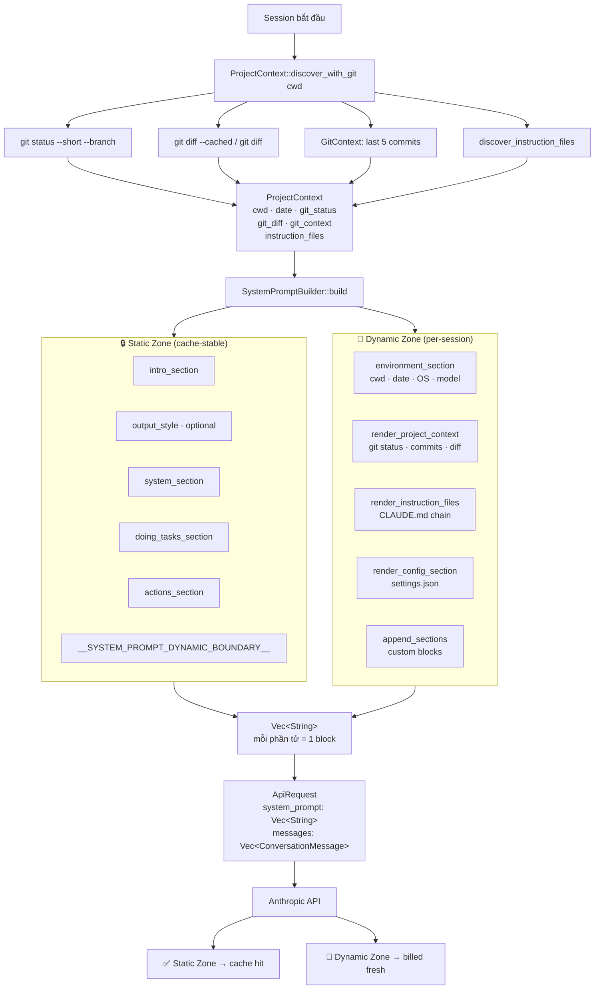

# Pattern 2 — Scoped Context Assembly

> **Tóm tắt:** System prompt không phải một chuỗi cứng (hardcoded string) — nó được lắp ráp động từ nhiều "block" độc lập trước mỗi API call, mỗi block mang một loại context khác nhau.

---

## Vấn đề nó giải quyết

Nếu bạn nhét tất cả vào một string duy nhất, bạn sẽ gặp hai vấn đề:

**Vấn đề 1 — Không thể cache hiệu quả.** API của Anthropic hỗ trợ prompt caching: nếu phần đầu của system prompt không thay đổi, nó được cache lại và không tốn tiền ở lần gọi tiếp theo. Nếu bạn nhúng git status (luôn thay đổi) vào ngay đầu string, bạn phá vỡ cache mọi lúc.

**Vấn đề 2 — Khó bảo trì.** Khi bạn muốn thêm context mới (ví dụ: thông tin về OS), bạn phải tìm đúng chỗ trong một string dài để chèn vào, không có cấu trúc rõ ràng.

**Giải pháp:** Tách system prompt thành nhiều block độc lập, mỗi block có vòng đời (lifetime) riêng. Block nào ổn định thì đứng trước → được cache. Block nào thay đổi theo session thì đứng sau.

---

## Source code trong repo

| File | Vai trò |
|------|---------|
| [`rust/crates/runtime/src/prompt.rs:94–195`](../rust/crates/runtime/src/prompt.rs#L94) | `SystemPromptBuilder` — builder pattern lắp ráp từng block |
| [`rust/crates/runtime/src/prompt.rs:144–166`](../rust/crates/runtime/src/prompt.rs#L144) | `build()` — trả về `Vec<String>`, mỗi phần tử là 1 block |
| [`rust/crates/runtime/src/prompt.rs:40`](../rust/crates/runtime/src/prompt.rs#L40) | `SYSTEM_PROMPT_DYNAMIC_BOUNDARY` — marker phân ranh giới static/dynamic |
| [`rust/crates/runtime/src/prompt.rs:54–91`](../rust/crates/runtime/src/prompt.rs#L54) | `ProjectContext` — container cho toàn bộ dynamic context (git, cwd, date, files) |
| [`rust/crates/runtime/src/prompt.rs:288–327`](../rust/crates/runtime/src/prompt.rs#L288) | `render_project_context()` — render git status, commits, diff |
| [`rust/crates/runtime/src/conversation.rs:22–26`](../rust/crates/runtime/src/conversation.rs#L22) | `ApiRequest` — payload gửi lên API, chứa `system_prompt: Vec<String>` |
| [`rust/crates/runtime/src/conversation.rs:351–355`](../rust/crates/runtime/src/conversation.rs#L351) | `run_turn()` — chỗ `ApiRequest` được tạo ra trước mỗi API call |
| [`rust/crates/runtime/src/conversation.rs:43–50`](../rust/crates/runtime/src/conversation.rs#L43) | `PromptCacheEvent` — telemetry theo dõi cache hit/miss của prompt |

---

## Mindset

Hãy nghĩ system prompt như một trang web được render server-side từ các **component độc lập**. Mỗi component được tính toán riêng, có cache policy riêng, có thể thay thế hoặc bỏ qua mà không ảnh hưởng đến phần còn lại.

Nguyên tắc sắp xếp: **ổn định → dễ thay đổi**.

```
[Ổn định nhất]   Intro, system rules, task rules       → cache tốt nhất
[Ổn định vừa]    CLAUDE.md, settings.json              → cache trung bình
[Thay đổi mọi lúc] Git status, diff, ngày tháng       → không cache
```

Nếu bạn đảo thứ tự — đặt git status lên đầu — thì phần đầu luôn khác nhau, cache không bao giờ hit.

---

## Architecture diagram



---

## Technical walkthrough

### Bước 1 — Collect dynamic context

Trước khi lắp ráp, harness thu thập tất cả thông tin thay đổi theo môi trường:

```
ProjectContext::discover_with_git(cwd)
  ├── git --no-optional-locks status --short --branch  → git_status
  ├── git diff --cached                                → staged changes
  ├── git diff                                         → unstaged changes
  ├── GitContext::detect()                             → recent_commits (last 5)
  └── discover_instruction_files()                     → CLAUDE.md chain
```

Kết quả là một `ProjectContext` struct chứa toàn bộ snapshot của môi trường tại thời điểm session bắt đầu.

### Bước 2 — Builder pattern lắp ráp từng block

`SystemPromptBuilder` dùng builder pattern để inject các thành phần một cách rõ ràng:

```rust
SystemPromptBuilder::new()
    .with_os(os_name, os_version)           // block: platform info
    .with_output_style(name, prompt)        // block: output style (optional)
    .with_project_context(project_context)  // block: git + CLAUDE.md
    .with_runtime_config(config)            // block: settings.json
    .append_section(custom)                 // block: custom extension
    .build()                                // → Vec<String>
```

Mỗi `.with_*()` call không làm gì ngay — nó chỉ lưu dữ liệu vào struct. Toàn bộ assembly xảy ra khi `.build()` được gọi.

### Bước 3 — build() lắp ráp theo thứ tự cố định

`build()` đẩy các block vào `Vec<String>` theo thứ tự bất biến:

```
[STATIC ZONE]
  intro_section
  output_style (nếu có)
  system_section
  doing_tasks_section
  actions_section
  "__SYSTEM_PROMPT_DYNAMIC_BOUNDARY__"   ← ranh giới

[DYNAMIC ZONE]
  environment_section    → cwd, date, OS, model name
  render_project_context → git state
  render_instruction_files → CLAUDE.md
  render_config_section  → settings.json
  append_sections        → custom blocks
```

Boundary marker `__SYSTEM_PROMPT_DYNAMIC_BOUNDARY__` là một literal string — không phải logic, không phải code. Nó chỉ là dấu phân cách để API biết cache đến đây.

### Bước 4 — Vec<String> gửi lên API như multi-block system

Kết quả `Vec<String>` **không** bị join thành một string rồi gửi đi. Nó được giữ nguyên dạng vector và đưa vào `ApiRequest`:

```rust
// conversation.rs:351-355
let request = ApiRequest {
    system_prompt: self.system_prompt.clone(),  // Vec<String> — nhiều block
    messages: self.session.messages.clone(),
};
```

Anthropic API nhận `system` parameter dưới dạng array of content blocks — mỗi phần tử của `Vec<String>` là một block riêng. API có thể cache từng block một cách độc lập.

### Bước 5 — Cache telemetry theo dõi hiệu quả

Mỗi API response có thể kèm `PromptCacheEvent`:

```rust
pub struct PromptCacheEvent {
    pub unexpected: bool,
    pub previous_cache_read_input_tokens: u32,
    pub current_cache_read_input_tokens: u32,
    pub token_drop: u32,  // số token bị mất cache đột ngột
}
```

`unexpected = true` + `token_drop > 0` = cache bị reset không mong muốn. Thường xảy ra khi dynamic content bị đặt sai vị trí, xâm phạm vào zone lẽ ra phải stable.

---

## Model thực sự nhận được gì

Sau khi `.render()` (join `Vec<String>` với `\n\n`), model thấy một chuỗi có cấu trúc như sau:

```
You are an interactive agent that helps users with software engineering tasks...

# System
 - All text you output outside of tool use is displayed to the user.
 ...

# Doing tasks
 - Read relevant code before changing it...

# Executing actions with care
...

__SYSTEM_PROMPT_DYNAMIC_BOUNDARY__

# Environment context
 - Model family: Claude Opus 4.6
 - Working directory: /home/user/projects/myrepo
 - Date: 2026-04-20
 - Platform: linux 6.8

# Project context
 - Today's date is 2026-04-20.
 - Working directory: /home/user/projects/myrepo
 - Claude instruction files discovered: 2.

Git status snapshot:
## main...origin/main
M  src/lib.rs

Recent commits (last 5):
  a1b2c3d feat: add feature X

# Claude instructions

## CLAUDE.md (scope: /home/user/projects/myrepo)
...nội dung CLAUDE.md...

# Runtime config
 - Loaded Project: /home/user/projects/myrepo/.claw/settings.json
{"permissionMode":"acceptEdits"}
```

---

## Nếu bạn tự build

```python
# pseudo-code

DYNAMIC_BOUNDARY = "__DYNAMIC_BOUNDARY__"

def assemble_system_prompt(cwd: Path) -> list[str]:
    # Static zone — luôn giống nhau, cache-stable
    blocks = [
        render_intro(),
        render_system_rules(),
        render_task_rules(),
        DYNAMIC_BOUNDARY,
    ]

    # Dynamic zone — thay đổi mỗi session
    blocks += [
        render_environment(cwd),
        render_git_context(cwd),
        *[render_instruction_file(f) for f in discover_instruction_files(cwd)],
        render_config(cwd),
    ]

    return blocks  # Giữ dạng list, KHÔNG join thành 1 string

# Gửi lên Anthropic API
response = client.messages.create(
    model="claude-opus-4-7",
    system=[{"type": "text", "text": block} for block in assemble_system_prompt(cwd)],
    messages=history,
)
```

Quy tắc thiết kế block order:

| Rule | Lý do |
|------|-------|
| Static blocks trước boundary | Stable content → cache hit rate cao |
| Dynamic blocks sau boundary | Thay đổi mọi session → không cần cache |
| Mỗi block là một unit độc lập | Có thể bật/tắt từng block không ảnh hưởng phần còn lại |
| Không đặt timestamp/ngày giờ ở block đầu | Phá vỡ cache ngay từ đầu |
| Giữ `list[str]` đến tận lúc gọi API | Mất multi-block nếu join sớm |

---

## Các cạm bẫy thường gặp

| Cạm bẫy | Hậu quả | Cách tránh |
|---------|---------|-----------|
| Nhúng git diff vào đầu prompt | Static zone bị "nhiễm" dynamic content, cache không bao giờ hit | Luôn đặt dynamic content SAU boundary marker |
| Hardcode ngày giờ vào intro | Prompt thay đổi mỗi ngày → cache miss hàng ngày | Đặt ngày giờ vào environment block (sau boundary) |
| Join thành 1 string rồi gửi | Mất khả năng cache từng block riêng | Giữ `list[str]` / `Vec<String>` cho đến lúc gọi API |
| Không tách collect vs render | Git state và CLAUDE.md bị tính toán lẫn lộn, khó test | Tách `ProjectContext` (collect data) khỏi `render_*` (render to string) |
| Append section ở đầu thay vì cuối | Section mới phá vỡ cache của tất cả block phía sau | Luôn extend ở cuối; dùng slot riêng trong builder nếu cần ưu tiên cao hơn |
