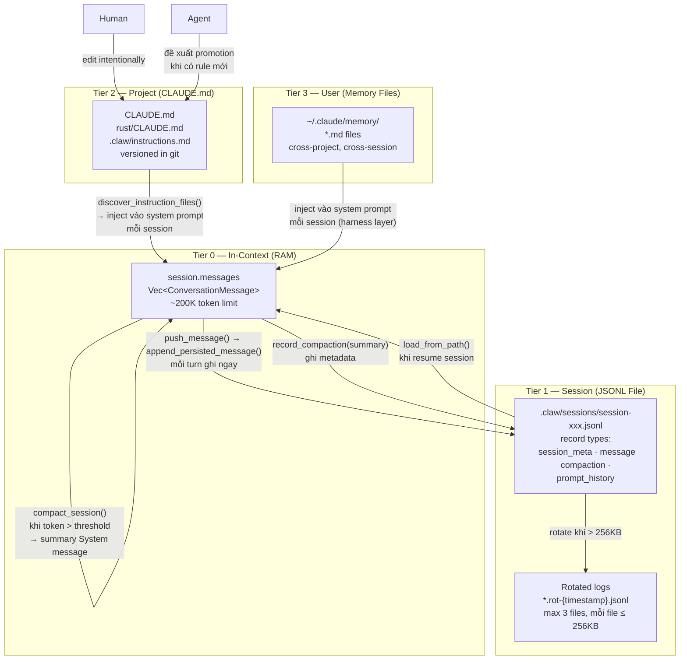

# Pattern 3 — Tiered Memory

> **Tóm tắt:** Agent không có một vùng nhớ duy nhất — nó có 4 "tầng" khác nhau, mỗi tầng có độ bền (durability), phạm vi (scope), và cách ghi/đọc khác nhau. Thông tin được lưu ở tầng phù hợp với tầm quan trọng của nó.

> **Lưu ý:** Pattern này *implicit* trong codebase — không có một struct hay file tên là "TieredMemory". Thay vào đó, 4 tầng tồn tại như hệ quả tự nhiên của cách nhiều cơ chế kết hợp với nhau.

---

## Vấn đề nó giải quyết

Nếu agent chỉ có một vùng nhớ (context window), bạn gặp hai vấn đề đối lập:

- **Quá ngắn:** Mỗi lần context reset, agent quên hết — phải giải thích lại project từ đầu.
- **Quá dài:** Nhồi nhét mọi thứ vào context window làm tăng chi phí, tăng nhiễu, giảm độ chính xác.

**Giải pháp:** Phân loại thông tin theo tầm quan trọng và độ thay đổi, rồi lưu vào đúng tầng. Thông tin dùng ngay → context window. Thông tin dùng lại trong session → JSONL file. Luật của project → CLAUDE.md. Sở thích dài hạn của user → memory files.

---

## Source code trong repo

| File | Tier | Vai trò |
|------|------|---------|
| `session.messages` trong [`session.rs:90–106`](../rust/crates/runtime/src/session.rs#L90) | Tier 0 | In-context: conversation history đang active |
| [`session.rs:13–14`](../rust/crates/runtime/src/session.rs#L13) | Tier 1 | Constants: `ROTATE_AFTER_BYTES = 256KB`, `MAX_ROTATED_FILES = 3` |
| [`session.rs:204–227`](../rust/crates/runtime/src/session.rs#L204) | Tier 1 | `save_to_path()` / `load_from_path()` — persist/restore session |
| [`session.rs:229–243`](../rust/crates/runtime/src/session.rs#L229) | Tier 1 | `push_message()` → `append_persisted_message()` — append JSONL on every turn |
| [`session.rs:54–60`](../rust/crates/runtime/src/session.rs#L54) | Tier 1 | `SessionCompaction` struct — metadata về compaction gần nhất |
| [`session.rs:249–257`](../rust/crates/runtime/src/session.rs#L249) | Tier 1 | `record_compaction()` — lưu summary sau mỗi lần compact |
| [`session.rs:1085–1141`](../rust/crates/runtime/src/session.rs#L1085) | Tier 1 | Log rotation: `rotate_session_file_if_needed()`, `cleanup_rotated_logs()` |
| [`compact.rs:96–183`](../rust/crates/runtime/src/compact.rs#L96) | Tier 0↔1 | `compact_session()` — cầu nối giữa tier 0 và tier 1 |
| `CLAUDE.md`, `rust/CLAUDE.md` | Tier 2 | Project-level rules, human-managed, versioned |
| `~/.claude/memory/` (external) | Tier 3 | User-level long-term memory, managed by harness |

---

## Mindset

Hãy nghĩ như cache hierarchy của CPU: L1 (fast, small, volatile) → L2 → L3 → RAM (slow, large, durable).

Mỗi tầng có đặc điểm khác nhau:

```
Tầng     │ Tốc độ đọc │ Dung lượng  │ Độ bền         │ Ai ghi
─────────┼────────────┼─────────────┼────────────────┼─────────────
Tier 0   │ Tức thì    │ ~200K token │ Session hiện tại│ Agent tự động
Tier 1   │ ms (I/O)   │ 256KB/file  │ Qua restart     │ Agent tự động
Tier 2   │ ms (I/O)   │ 12K chars   │ Vĩnh cửu        │ Human (git)
Tier 3   │ ms (I/O)   │ Không giới hạn│ Cross-project  │ Agent + Human
```

Nguyên tắc **promotion**: thông tin quan trọng cần "thăng hạng" lên tier cao hơn. Khi agent phát hiện ra một quy tắc mới đáng nhớ, nó nên đề xuất thêm vào `CLAUDE.md` (tier 2) thay vì chỉ giữ trong session (tier 1).

---

## Diagram



---

## Technical walkthrough

### Tier 0 — In-Context: Bộ nhớ đang hoạt động

`session.messages: Vec<ConversationMessage>` là tất cả những gì model đang "nhớ" trong lúc làm việc. Mỗi message có:

```
ConversationMessage {
    role: User | Assistant | Tool | System,
    blocks: Vec<ContentBlock>,  // Text | ToolUse | ToolResult
    usage: Option<TokenUsage>,
}
```

**Giới hạn:** Context window của model (~200K tokens). Khi vượt quá, tier 0 phải được compacted.

**Đặc điểm:** Sửa đổi trực tiếp trong RAM, không cần I/O. Mất khi process kết thúc (nếu không được persist xuống tier 1).

---

### Tier 1 — Session: Bộ nhớ qua restart

Mỗi message được ghi xuống disk **ngay lập tức** qua `append_persisted_message()`:

```
push_message(msg)
  → messages.push(msg)         [tier 0]
  → append_persisted_message() [tier 1]
     → nếu file chưa tồn tại: save_to_path() (full snapshot)
     → nếu đã có: OpenOptions::append(true) → writeln!(file, message_record)
```

**JSONL format** — mỗi dòng là một JSON record với `type` field:

```jsonl
{"type":"session_meta","version":1,"session_id":"session-1775011562247-0","created_at_ms":...}
{"type":"compaction","count":1,"removed_message_count":8,"summary":"..."}
{"type":"prompt_history","timestamp_ms":...,"text":"..."}
{"type":"message","message":{"role":"user","blocks":[...]}}
{"type":"message","message":{"role":"assistant","blocks":[...]}}
```

**Log rotation:** Khi file vượt `ROTATE_AFTER_BYTES = 256KB`, file cũ được rename thành `session.rot-{timestamp}.jsonl`. Tối đa `MAX_ROTATED_FILES = 3` file rotated được giữ lại; phần còn lại bị xóa tự động.

**Atomic write:** `save_to_path()` → ghi ra `{path}.tmp-{time}-{counter}` rồi `rename()` → không bao giờ để file ở trạng thái bị cắt nửa chừng.

---

### Tier 0 ↔ Tier 1: Compaction là cầu nối

Khi tier 0 sắp đầy (token count > threshold), `compact_session()` thực hiện một quá trình đặc biệt:

1. **Summarize** các message cũ thành `summary` string (xem Pattern 4 để hiểu chi tiết)
2. **Tạo System message** với nội dung: `COMPACT_CONTINUATION_PREAMBLE + summary`
3. **Thay thế** phần đầu của `session.messages` bằng System message + N messages gần nhất
4. **Ghi metadata** vào `session.compaction: SessionCompaction { count, removed_message_count, summary }`

```
Trước compaction:
  messages = [user, assistant, tool, user, assistant, user, assistant]  (7 messages)

Sau compaction (preserve_recent_messages = 2):
  messages = [System("Summary: ..."), user, assistant]  (3 messages)
  compaction = { count: 1, removed_message_count: 5, summary: "..." }
```

Kết quả: tier 0 "mỏng" lại nhưng không mất thông tin quan trọng — thông tin đó đã được "đúc" vào System message.

**Compaction lần 2** (nếu session tiếp tục dài): `merge_compact_summaries()` nhận biết summary cũ qua `COMPACT_CONTINUATION_PREAMBLE` prefix, và merge "Previously compacted context" với "Newly compacted context" — tránh mất lịch sử nhiều cấp.

---

### Tier 2 — Project: Luật bất biến

`CLAUDE.md` là tier duy nhất **không bao giờ bị ghi đè tự động** bởi agent. Nó được load vào mỗi session qua `discover_instruction_files()` (xem Pattern 1), nhưng chỉ được cập nhật khi human edit và commit.

**Scope hierarchy:** root CLAUDE.md → sub-workspace CLAUDE.md → `.claw/instructions.md`. Scope gần nhất được load sau cùng (ưu tiên cao hơn).

---

### Tier 3 — User: Bộ nhớ xuyên project

`~/.claude/memory/*.md` là nơi lưu những gì agent học được về *người dùng* qua nhiều project và session. Ví dụ: sở thích coding style, background kỹ thuật, các quyết định đã đưa ra.

Tier này được manage bởi harness layer bên ngoài codebase này — không có Rust code trực tiếp. Agent có thể viết memory file mới thông qua tool calls, và harness inject chúng vào system prompt khi session bắt đầu.

---

## Vòng đời thực tế của một thông tin

```
User nói: "Dự án này dùng Rust nightly, nhớ đấy nhé"
         │
         ▼
  [Tier 0] Thêm vào context window ngay
         │
         ▼
  [Tier 1] push_message() → ghi vào JSONL
         │
         │   Nếu agent muốn nhớ lâu dài:
         ▼
  [Tier 3] Viết memory file: "user prefers rust nightly"
           Lần sau sẽ được inject vào system prompt

         │
         │   Nếu là luật của project:
         ▼
  [Tier 2] Agent đề xuất thêm vào CLAUDE.md:
           "Use Rust nightly for all builds."
           Human review → commit → vĩnh cửu
```

---

## Nếu bạn tự build

```python
# pseudo-code

class TieredMemory:
    def __init__(self, session_path: Path, project_root: Path, user_home: Path):
        # Tier 0 — in-context
        self.messages: list[Message] = []

        # Tier 1 — session file
        self.session_path = session_path  # .jsonl file

        # Tier 2 — project rules (read-only, loaded once)
        self.project_rules = load_instruction_files(project_root)

        # Tier 3 — user memory (read-only, loaded once)
        self.user_memory = load_memory_files(user_home / ".claude/memory")

    def push(self, message: Message):
        self.messages.append(message)          # tier 0
        append_jsonl(self.session_path, message)  # tier 1

    def resume(self) -> list[Message]:
        return load_jsonl(self.session_path)  # restore tier 0 from tier 1

    def build_system_prompt(self) -> list[str]:
        return [
            *self.project_rules,   # tier 2 → context
            *self.user_memory,     # tier 3 → context
        ]

    def compact_if_needed(self, token_limit: int):
        if count_tokens(self.messages) > token_limit:
            summary = summarize(self.messages[:-4])    # giữ 4 message gần nhất
            self.messages = [system_message(summary)] + self.messages[-4:]
            append_jsonl(self.session_path, {"type": "compaction", "summary": summary})
```

Quy tắc thiết kế:

| Rule | Lý do |
|------|-------|
| Ghi tier 1 ngay lập tức (append), không batch | Tránh mất data nếu process crash giữa chừng |
| Dùng atomic write (write temp → rename) | File không bao giờ bị corrupt một nửa |
| Tier 2 chỉ human ghi, không auto-overwrite | Tránh agent tự sửa luật của mình |
| Compaction summary không thay thế hoàn toàn | Merge với previous summary nếu đã compact trước đó |

---

## Các cạm bẫy thường gặp

| Cạm bẫy | Hậu quả | Cách tránh |
|---------|---------|-----------|
| Ghi tier 1 theo batch (sau mỗi session) | Mất toàn bộ session nếu crash | Append ngay sau mỗi `push_message()` |
| Không dùng atomic write | File bị corrupt nếu ghi dở chừng | Write to `.tmp` rồi `rename()` |
| Nhồi user memory vào tier 0 thủ công | Context bị phình to, chi phí tăng | Inject vào system prompt (tier 2/3), không phải messages |
| Compaction quá aggressive | Agent mất thông tin quan trọng đang dở | Luôn giữ N message gần nhất verbatim (`preserve_recent_messages`) |
| Không merge summary cũ khi compact lần 2 | Lần compact thứ 2 overwrite context của lần 1 | Kiểm tra `COMPACT_CONTINUATION_PREAMBLE` prefix để detect existing summary |
