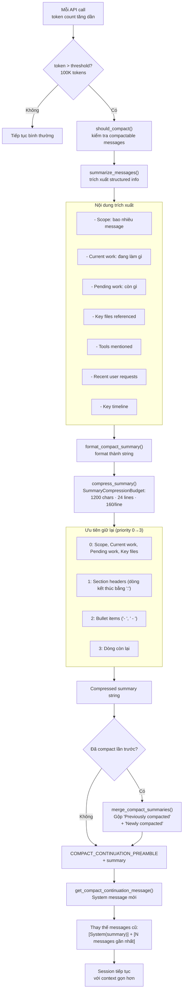

# Pattern 4 — Dream Consolidation

> **Tóm tắt:** Khi session sắp đầy, agent không bị "cắt ngang" — nó tự tóm tắt những gì đã xảy ra thành một System message dày đặc thông tin, rồi tiếp tục làm việc với context mới nhưng không mất mạch.

> **Tên gọi:** "Dream Consolidation" — ẩn dụ từ cơ chế não người: trong giấc ngủ, não hợp nhất ký ức rời rạc thành kiến thức cô đọng, loại bỏ chi tiết thừa, giữ lại bản chất. Agent làm điều tương tự khi context sắp đầy.

---

## Vấn đề nó giải quyết

Context window có giới hạn (~200K token). Nếu một task chạy dài — nhiều vòng explore-plan-act, nhiều file đọc, nhiều tool call — session sẽ đến giới hạn này.

Hai cách xử lý ngây thơ đều tệ:

- **Truncate đầu:** Xóa message cũ → agent mất lý do tại sao nó đang làm việc hiện tại.
- **Crash/reset:** Bắt đầu lại từ đầu → mất toàn bộ tiến trình.

**Giải pháp:** Trước khi context đầy, hỏi chính model: *"Tóm tắt lại những gì quan trọng từ cuộc hội thoại này."* Dùng summary đó làm "bộ nhớ" cho các vòng tiếp theo.

---

## Source code trong repo

| File | Vai trò |
|------|---------|
| [`compact.rs:3–4`](../rust/crates/runtime/src/compact.rs#L3) | `COMPACT_CONTINUATION_PREAMBLE` — văn bản seed inject trước summary |
| [`compact.rs:10–22`](../rust/crates/runtime/src/compact.rs#L10) | `CompactionConfig` — cấu hình: số message giữ lại, token budget |
| [`compact.rs:96–183`](../rust/crates/runtime/src/compact.rs#L96) | `compact_session()` — toàn bộ thuật toán consolidation |
| [`compact.rs:195–280`](../rust/crates/runtime/src/compact.rs#L195) | `summarize_messages()` — trích xuất structured info từ history |
| [`compact.rs:282–315`](../rust/crates/runtime/src/compact.rs#L282) | `merge_compact_summaries()` — gộp summary cũ + mới khi compact nhiều lần |
| [`summary_compression.rs:37–88`](../rust/crates/runtime/src/summary_compression.rs#L37) | `compress_summary()` — cắt summary để vừa budget |
| [`summary_compression.rs:8–22`](../rust/crates/runtime/src/summary_compression.rs#L8) | `SummaryCompressionBudget` — giới hạn: 1200 chars, 24 dòng, 160 chars/dòng |
| [`summary_compression.rs:174–183`](../rust/crates/runtime/src/summary_compression.rs#L174) | `line_priority()` — thứ tự ưu tiên giữ lại dòng khi cắt |

---

## Mindset

Hãy nghĩ như một người viết nhật ký công việc cuối ngày. Họ không chép lại toàn bộ Slack history — họ ghi: *"Hôm nay: debug issue X, tìm ra nguyên nhân ở module Y, fix xong nhưng chưa test. Ngày mai: chạy test, review với team."*

Đó chính xác là những gì Dream Consolidation làm:

```
Từ: 200 messages với tool calls, file reads, lỗi, retry, thảo luận
Đến: ~20 dòng cô đọng: scope, việc đang làm, việc còn lại, file quan trọng
```

**Điểm then chốt:** Chính model tạo ra summary — không phải một thuật toán ngoài. Model hiểu *ý nghĩa* của những gì nó đã làm, không chỉ copy text.

---

## Diagram



---

## Technical walkthrough

### Bước 1 — Trigger: `should_compact()` quyết định

Trước mỗi API call, runtime kiểm tra xem có cần compact không:

```
should_compact(session, config)
  → đếm số "compactable messages" (loại trừ System messages)
  → nếu token ước tính > config.max_estimated_tokens: return true
```

`CompactionConfig` mặc định:
```
preserve_recent_messages: 4   ← luôn giữ nguyên 4 message gần nhất
max_estimated_tokens: 10_000  ← threshold để quyết định compact
```

---

### Bước 2 — `summarize_messages()` trích xuất structured info

Không phải "tóm tắt tự do" — hàm này trích xuất theo cấu trúc cố định từ lịch sử hội thoại:

```
summarize_messages(messages) → CompactionSummaryData {
    scope: "18 messages compacted",
    current_work: "đang implement X",
    pending_work: "cần test Y",
    key_files: ["src/main.rs", "tests/integration.rs"],
    tools_mentioned: ["Read", "Edit", "Bash"],
    recent_user_requests: ["fix bug Z", "add feature W"],
    timeline: [("user", "asked for..."), ("assistant", "found..."), ...]
}
```

---

### Bước 3 — `format_compact_summary()` → `compress_summary()`

Structured data được format thành string rồi nén xuống budget:

**Budget mặc định (`SummaryCompressionBudget`):**
```
max_chars:      1_200   ← tổng ký tự
max_lines:         24   ← tổng số dòng
max_line_chars:   160   ← mỗi dòng tối đa
```

**Quá trình nén** (`compress_summary()`):
1. **Normalize:** xóa blank lines, collapse whitespace thừa
2. **Deduplicate:** xóa dòng trùng lặp (case-insensitive)
3. **Truncate dòng dài:** cắt tại 160 ký tự + thêm `…`
4. **Chọn dòng theo priority** (từ quan trọng nhất → ít quan trọng nhất):
   - Priority 0: `- Scope:`, `- Current work:`, `- Pending work:`, `- Key files referenced:` — **luôn giữ trước**
   - Priority 1: Section headers (dòng kết thúc bằng `:`)
   - Priority 2: Bullet items (`- ` hoặc `  - `)
   - Priority 3: Dòng khác
5. **Omission notice:** nếu có dòng bị cắt, thêm `- … N additional line(s) omitted.`

Kết quả: summary vừa budget nhưng giữ được thông tin cốt lõi nhất.

---

### Bước 4 — Xử lý compact nhiều lần: `merge_compact_summaries()`

Nếu session đã được compact trước đó, summary cũ không bị overwrite — nó được **merge**:

```
Compact lần 1:
  System message = PREAMBLE + "Newly compacted context: [summary1]"

Compact lần 2:
  merge_compact_summaries(old_summary, new_summary)
  → System message = PREAMBLE +
    "Previously compacted context: [summary1]" +
    "Newly compacted context: [summary2]"
```

Cơ chế detect: hàm kiểm tra xem System message hiện tại có bắt đầu bằng `COMPACT_CONTINUATION_PREAMBLE` không. Nếu có → đây là summary cũ, cần merge.

**Tại sao không chỉ keep summary mới nhất?** Vì summary mới chỉ tóm tắt những gì xảy ra *kể từ lần compact trước*. Nếu loại bỏ summary cũ, agent mất lịch sử của *toàn bộ session* trước đó.

---

### Bước 5 — Kết quả: session được "làm mỏng"

```
Trước compact:
  messages = [user, assistant, tool, user, assistant, ...] (100 messages)

Sau compact (preserve_recent_messages = 4):
  messages = [
    System("Conversation summary:\n- Scope: 96 messages compacted\n- Current work: ..."),
    user_message_97,
    assistant_message_98,
    user_message_99,
    assistant_message_100,
  ]
```

Model tiếp tục từ đây — nó "biết" mọi thứ quan trọng đã xảy ra, chỉ không nhớ từng câu chữ cụ thể.

---

## Output thực tế mà model nhận được

Sau khi compact, System message đầu tiên của session trông như sau:

```
This is a continuation of a previous conversation. 
The following is a summary of the conversation so far:

Conversation summary:
- Scope: 18 earlier messages compacted.
- Current work: implementing compact_session() in runtime module.
- Pending work: write tests for edge cases; update CLAUDE.md.
- Key files referenced: rust/crates/runtime/src/compact.rs, rust/crates/runtime/src/session.rs
- Tools mentioned: Read, Edit, Bash, Grep
- Recent user requests: add merge logic for multi-compaction
- Key timeline:
  - user: asked to implement dream consolidation
  - assistant: read compact.rs and found summarize_messages()
  - tool: cargo check succeeded after edits
```

---

## Nếu bạn tự build

```python
# pseudo-code

PREAMBLE = "This is a continuation of a previous conversation.\nThe following is a summary:\n\n"

def compact_session(messages: list[Message], preserve_recent: int = 4) -> list[Message]:
    if len(messages) <= preserve_recent:
        return messages

    messages_to_compact = messages[:-preserve_recent]
    recent_messages = messages[-preserve_recent:]

    # Bước 1: trích xuất structured info
    summary_data = extract_summary_info(messages_to_compact)

    # Bước 2: format thành string
    raw_summary = format_summary(summary_data)

    # Bước 3: nén xuống budget
    compressed = compress_to_budget(
        summary=raw_summary,
        max_chars=1200,
        max_lines=24,
        priority_order=["Scope", "Current work", "Pending work", "Key files"]
    )

    # Bước 4: kiểm tra xem đã compact lần trước chưa
    existing_system = find_system_message(messages)
    if existing_system and existing_system.startswith(PREAMBLE):
        # merge summaries
        old_summary = extract_summary_from_system(existing_system)
        final_summary = (
            f"Previously compacted context:\n{old_summary}\n\n"
            f"Newly compacted context:\n{compressed}"
        )
    else:
        final_summary = compressed

    # Bước 5: tạo System message mới
    system_message = Message(role="system", content=PREAMBLE + final_summary)

    return [system_message] + recent_messages

def extract_summary_info(messages: list[Message]) -> dict:
    return {
        "scope": f"{len(messages)} earlier messages compacted",
        "current_work": infer_current_work(messages),
        "pending_work": infer_pending(messages),
        "key_files": extract_file_references(messages),
        "tools": extract_tool_names(messages),
        "recent_requests": extract_user_requests(messages[-5:]),
        "timeline": build_timeline(messages[-10:]),
    }
```

Quy tắc thiết kế:

| Rule | Lý do |
|------|-------|
| Model tự tóm tắt, không dùng thuật toán ngoài | Model hiểu *ngữ nghĩa* — "đang debug X" quan trọng hơn "file Y được đọc 3 lần" |
| Structured extraction (không free-form) | Đảm bảo các trường quan trọng (`pending_work`) luôn có mặt trong summary |
| Priority-based compression | Khi budget ít, giữ `Scope` + `Current work` + `Pending work` trước tiên |
| Merge thay vì overwrite | Compact lần 2 không được xóa context của lần 1 |
| Giữ N message gần nhất verbatim | Recency bias — hành động ngay trước mặt quan trọng hơn bất kỳ summary nào |

---

## Các cạm bẫy thường gặp

| Cạm bẫy | Hậu quả | Cách tránh |
|---------|---------|-----------|
| Compact tất cả message, không giữ gần nhất | Model không biết nó vừa làm gì → lặp lại | Luôn giữ `preserve_recent_messages` message verbatim |
| Compact lần 2 overwrite summary lần 1 | Agent mất toàn bộ lịch sử trước lần compact đầu tiên | Detect `PREAMBLE` prefix → merge, không overwrite |
| Summary quá dài (vượt budget) | Tốn token vô ích; có thể bị truncate ngẫu nhiên | Dùng priority-based compression với budget cứng |
| Free-form summary không có cấu trúc | `pending_work` hay bị thiếu → agent quên việc còn lại | Structured extraction với các trường bắt buộc |
| Compact quá sớm (threshold quá thấp) | Mất thông tin trước khi cần thiết | Threshold phải đủ lớn để giữ context hữu ích |
| Compact quá muộn (threshold quá cao) | Đạt hard limit của API trước khi compact kịp | Compact khi còn đủ "room" để model generate summary |
