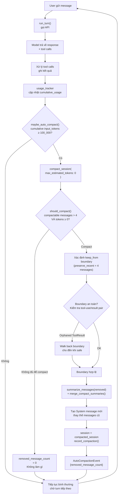

# Pattern 5 — Progressive Context Compaction

> **Tóm tắt:** Compaction không phải một sự kiện một lần — nó được kiểm tra tự động sau *mỗi turn*, trigger dựa trên lượng token tích lũy, và đảm bảo session không bao giờ chạm hard limit của API.

> **Phân biệt với Pattern 4:** Pattern 4 giải thích *cơ chế* — cách tạo ra summary. Pattern 5 giải thích *chính sách trigger* — khi nào compaction được kích hoạt, bằng cách nào, và tại sao nó "progressive" chứ không phải một lần duy nhất.

---

## Vấn đề nó giải quyết

Nếu compaction chỉ xảy ra khi context "đầy cứng":

- **Quá muộn:** API hard limit (~200K token) bị hit → request fail → mất toàn bộ turn đang xử lý.
- **Không có room:** Để tạo summary, model cần token để generate. Nếu đã đến hard limit, không còn room để generate summary.
- **Unpredictable:** User không biết khi nào session sẽ "chết" — ở turn 50 hay turn 500?

**Giải pháp:** Compact sớm, compact liên tục. Kiểm tra sau mỗi turn. Trigger ở 100K token tích lũy — còn 100K room để model tiếp tục làm việc trước khi cần compact lần tiếp theo.

---

## Source code trong repo

| File | Vai trò |
|------|---------|
| [`conversation.rs:18–19`](../rust/crates/runtime/src/conversation.rs#L18) | `DEFAULT_AUTO_COMPACTION_INPUT_TOKENS_THRESHOLD = 100_000` — ngưỡng ngoài |
| [`conversation.rs:555–578`](../rust/crates/runtime/src/conversation.rs#L555) | `maybe_auto_compact()` — kiểm tra sau mỗi turn |
| [`compact.rs:41–51`](../rust/crates/runtime/src/compact.rs#L41) | `should_compact()` — ngưỡng trong (session-level) |
| [`compact.rs:10–22`](../rust/crates/runtime/src/compact.rs#L10) | `CompactionConfig { preserve_recent_messages: 4, max_estimated_tokens: 10_000 }` |
| [`compact.rs:115–158`](../rust/crates/runtime/src/compact.rs#L115) | Tool-use/tool-result boundary safety logic |
| [`compact.rs:96–183`](../rust/crates/runtime/src/compact.rs#L96) | `compact_session()` — gọi từ `maybe_auto_compact()` |

---

## Mindset

Hãy nghĩ như một bộ đệm circular với auto-flush. Bạn không đợi bộ đệm tràn — bạn flush định kỳ khi đến ngưỡng, trong khi còn room để flush an toàn.

```
Sai: đợi đến 200K → panic → crash
Đúng: kiểm tra sau mỗi turn → compact ở 100K → còn 100K room → tiếp tục bình thường
```

**"Progressive"** ở đây có nghĩa: không phải một lần, mà là một vòng lặp liên tục. Mỗi turn là một checkpoint. Nếu đến ngưỡng → compact → reset → tiếp tục. Session có thể chạy hàng trăm, hàng nghìn turn mà không bao giờ crash.

---

## Diagram



---

## Technical walkthrough

### Bước 1 — Ngưỡng ngoài: cumulative input tokens

`maybe_auto_compact()` được gọi sau mỗi turn:

```rust
// conversation.rs:555-578
fn maybe_auto_compact(&mut self) -> Option<AutoCompactionEvent> {
    if self.usage_tracker.cumulative_usage().input_tokens
        < self.auto_compaction_input_tokens_threshold  // mặc định: 100_000
    {
        return None;
    }

    let result = compact_session(
        &self.session,
        CompactionConfig {
            max_estimated_tokens: 0,  // ← force compact ngay
            ..CompactionConfig::default()
        },
    );
    // ...
}
```

**Hai điểm quan trọng:**
- Threshold là **cumulative input tokens** — tổng số token gửi lên API từ đầu session, không phải token của session hiện tại tại một thời điểm. Điều này phản ánh "bao nhiêu công sức đã bỏ ra".
- Khi trigger, `max_estimated_tokens: 0` → `should_compact()` sẽ pass ngay (0 ≤ bất kỳ số nào ≥ 0) → compact không điều kiện.

**Có thể override** qua env var:
```
CLAUDE_CODE_AUTO_COMPACT_INPUT_TOKENS=50000  # compact sớm hơn
```

---

### Bước 2 — Ngưỡng trong: `should_compact()`

`should_compact()` kiểm tra **session-level** — bỏ qua System summary prefix nếu đã có từ lần compact trước:

```rust
// compact.rs:41-51
pub fn should_compact(session: &Session, config: CompactionConfig) -> bool {
    let start = compacted_summary_prefix_len(session);  // bỏ qua System message nếu là summary
    let compactable = &session.messages[start..];

    compactable.len() > config.preserve_recent_messages   // phải có đủ để compact
        && compactable.iter()
            .map(estimate_message_tokens)
            .sum::<usize>()
            >= config.max_estimated_tokens                // phải đủ token
}
```

Khi được gọi từ `maybe_auto_compact()` với `max_estimated_tokens: 0`:
- Điều kiện 1: `compactable.len() > 4` — cần có hơn 4 messages để compact
- Điều kiện 2: `tokens >= 0` — luôn đúng

→ Compact xảy ra miễn là có > 4 messages để compact.

---

### Bước 3 — Boundary safety: không cắt ngang tool-use/result pair

Đây là chi tiết quan trọng thường bị bỏ qua. Khi xác định `keep_from` (ranh giới giữa phần bị compact và phần được giữ), code phải đảm bảo không cắt ngang cặp `ToolUse` → `ToolResult`:

```
Vấn đề:
  messages = [..., assistant(ToolUse), user(ToolResult), user, assistant]
                    ^--- compact đến đây              ^--- giữ từ đây
                         ToolUse bị xóa, nhưng ToolResult vẫn còn → orphaned!
```

Một số API (OpenAI-compatible) trả về lỗi 400 nếu gặp `tool` role message mà không có `assistant` message với `tool_calls` ngay trước đó.

**Fix:** Walk back boundary cho đến khi `first_preserved` không bắt đầu bằng `ToolResult`, hoặc cho đến khi `ToolUse` pair được giữ lại cùng.

```
Sau fix:
  messages = [..., assistant(ToolUse), user(ToolResult), user, assistant]
                   ^--- giữ từ đây (walk back 1 bước)
```

---

### Bước 4 — Sau compact: session được replace

```rust
// conversation.rs:574
self.session = result.compacted_session;
```

Session mới có:
- `messages[0]` = System message với summary (từ Pattern 4)
- `messages[1..5]` = 4 messages gần nhất verbatim
- `compaction` metadata được ghi vào session file (Tier 1 trong Pattern 3)

---

### Hai ngưỡng hoạt động song song

```
Ngưỡng ngoài (conversation.rs):
  cumulative_input_tokens ≥ 100_000
  → Đây là "khi nào kiểm tra"
  → Dựa trên tổng token gửi lên API từ đầu session

Ngưỡng trong (compact.rs):
  session_tokens ≥ max_estimated_tokens
  → Đây là "khi nào thực sự compact"
  → Dựa trên token ước tính trong session hiện tại
  → Khi gọi từ maybe_auto_compact(): set = 0 → always compact
  → Khi gọi thủ công (e.g. /compact): dùng CompactionConfig::default()
```

Tách hai ngưỡng cho phép:
- **User-triggered `/compact`**: dùng default config, chỉ compact nếu session thực sự đủ lớn
- **Auto-compact**: trigger khi đã dùng nhiều token tích lũy, compact không điều kiện

---

## Vòng lặp đầy đủ: session không có điểm kết thúc

```
Turn 1:   cumulative = 1K tokens   → không compact
Turn 10:  cumulative = 15K tokens  → không compact
Turn 30:  cumulative = 80K tokens  → không compact
Turn 35:  cumulative = 102K tokens → COMPACT → session về 4 messages + summary
Turn 36:  cumulative = 103K tokens → compact ngay lập tức (vẫn > 100K)
           → nhưng removed_message_count = 0 (chỉ có 5 messages, > 4 là đủ)
           → thực ra compact được 1 message
Turn 50:  cumulative = 130K tokens → compact lại
...
```

Session có thể chạy vô hạn — mỗi compact giữ cho context window luôn ở mức "vừa phải".

---

## Nếu bạn tự build

```python
# pseudo-code

DEFAULT_THRESHOLD = 100_000  # cumulative input tokens
PRESERVE_RECENT = 4

class ConversationRuntime:
    def __init__(self):
        self.session = Session()
        self.cumulative_input_tokens = 0
        self.threshold = int(os.getenv("AUTO_COMPACT_TOKENS", DEFAULT_THRESHOLD))

    def run_turn(self, user_message: str):
        # 1. Thêm user message
        self.session.push(user_message)

        # 2. Gọi API
        response = call_api(
            system=self.build_system_prompt(),
            messages=self.session.messages
        )

        # 3. Cập nhật cumulative token count
        self.cumulative_input_tokens += response.usage.input_tokens

        # 4. Xử lý response, thêm vào session
        self.session.push(response.message)
        process_tool_calls(response)

        # 5. Kiểm tra compact SAU MỖI TURN
        self.maybe_auto_compact()

        return response

    def maybe_auto_compact(self):
        if self.cumulative_input_tokens < self.threshold:
            return  # chưa đến ngưỡng

        result = compact_session(
            session=self.session,
            force=True,            # max_estimated_tokens = 0
            preserve_recent=PRESERVE_RECENT
        )

        if result.removed_count == 0:
            return  # không đủ để compact

        self.session = result.compacted_session
        log(f"Auto-compacted: removed {result.removed_count} messages")

def compact_session(session, force=False, preserve_recent=4):
    compactable = get_compactable_messages(session)  # bỏ qua System summary prefix

    # Kiểm tra có đủ để compact không
    if len(compactable) <= preserve_recent:
        return CompactionResult(removed_count=0, compacted_session=session)

    if not force and estimate_tokens(compactable) < 10_000:
        return CompactionResult(removed_count=0, compacted_session=session)

    # Xác định boundary (cẩn thận với tool-use/result pairs!)
    keep_from = len(session.messages) - preserve_recent
    keep_from = walk_back_if_orphaned_tool_result(session.messages, keep_from)

    # Compact
    removed = compactable[:keep_from]
    preserved = session.messages[keep_from:]
    summary = merge_compact_summaries(get_existing_summary(session), summarize(removed))

    new_messages = [make_system_message(summary)] + preserved
    return CompactionResult(
        removed_count=len(removed),
        compacted_session=Session(messages=new_messages)
    )
```

Quy tắc thiết kế:

| Rule | Lý do |
|------|-------|
| Compact sau mỗi turn, không batch | Không bao giờ để session đến hard limit của API |
| Threshold dựa trên cumulative tokens, không session size | Phản ánh "đã dùng bao nhiêu" — signal tốt hơn "hiện có bao nhiêu" |
| `max_estimated_tokens = 0` khi auto-compact | Không cần kiểm tra lại — outer threshold đã quyết định |
| Walk back boundary nếu orphaned tool result | Tránh lỗi 400 từ OpenAI-compatible APIs |
| Giữ `preserve_recent` verbatim | Recency bias — hành động gần nhất không được mất dù compact |

---

## Các cạm bẫy thường gặp

| Cạm bẫy | Hậu quả | Cách tránh |
|---------|---------|-----------|
| Compact chỉ một lần khi đầy | API hard limit hit trước khi compact kịp | Compact sau mỗi turn dựa trên cumulative tokens |
| Threshold quá cao (gần hard limit) | Không còn room để model generate summary | Compact ở 50–60% hard limit, không phải 95% |
| Không handle orphaned ToolResult | API trả về 400 | Walk back boundary đến khi tool-use pair nguyên vẹn |
| Compact khi chỉ có 2–3 messages | Xóa 0 messages, tốn compute vô ích | Kiểm tra `len(compactable) > preserve_recent` trước |
| Dùng session token count thay vì cumulative | Miss trigger khi session đã được compact (size nhỏ nhưng đã "cũ") | Theo dõi cumulative usage riêng biệt qua `usage_tracker` |
