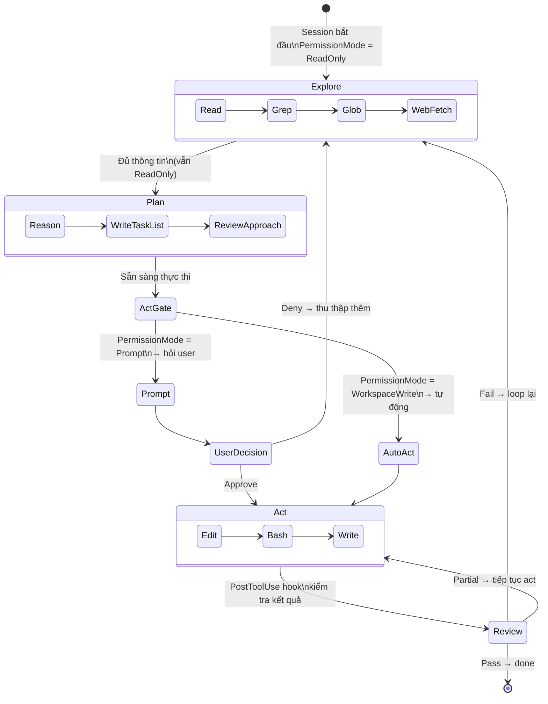

# Pattern 6 — Explore-Plan-Act Loop

> **Tóm tắt:** Agent không nhảy thẳng vào viết code — nó đi qua ba pha có thứ tự: *Explore* (chỉ đọc, thu thập thông tin), *Plan* (lý luận và lập kế hoạch), *Act* (thực thi). Permission mode kiểm soát ranh giới giữa các pha.

---

## Vấn đề nó giải quyết

Nếu agent được phép làm bất cứ thứ gì ngay từ đầu, nó sẽ:

- Tự tin viết code khi chưa hiểu đủ context → sai hướng.
- Sửa file trước khi đọc xem file đó làm gì → phá vỡ invariants.
- Commit mà không kiểm tra test → regressions.

Đây là failure mode điển hình: *"Act before thinking."*

**Giải pháp:** Phân chia rõ ràng ba pha, mỗi pha có công cụ và quyền hạn khác nhau. Permission system của harness enforce ranh giới — không phải chỉ "nhắc nhở" trong CLAUDE.md.

---

## Source code trong repo

| File | Vai trò |
|------|---------|
| [`PHILOSOPHY.md`](../PHILOSOPHY.md) | Triết lý tổng thể: planning → execution → review → retry loop |
| [`permissions.rs:9–15`](../rust/crates/runtime/src/permissions.rs#L9) | `PermissionMode` enum — 5 mode ánh xạ vào các pha |
| [`permissions.rs:97–105`](../rust/crates/runtime/src/permissions.rs#L97) | `PermissionPolicy` — allow/deny/ask rules + active mode |
| [`permissions.rs:175–292`](../rust/crates/runtime/src/permissions.rs#L175) | `authorize_with_context()` — decision logic trước mỗi tool call |
| [`permissions.rs:68–83`](../rust/crates/runtime/src/permissions.rs#L68) | `PermissionRequest` — mô tả yêu cầu leo thang permission |
| [`hooks.rs:22–26`](../rust/crates/runtime/src/hooks.rs#L22) | `HookEvent` — `PreToolUse`, `PostToolUse`, `PostToolUseFailure` |
| [`hooks.rs:39–56`](../rust/crates/runtime/src/hooks.rs#L39) | `HookProgressEvent` — Started / Completed / Cancelled |

---

## Mindset

**Từ PHILOSOPHY.md:** *"Humans set direction; claws perform the labor."* Nhưng trước khi thực thi, claws phải hiểu. Trước khi hiểu, chúng phải quan sát.

Nghĩ như một kỹ sư kinh nghiệm nhận task mới:

```
❌ Junior: nhận task → viết code ngay → phát hiện sai → rewrite
✅ Senior: nhận task → đọc codebase → lập kế hoạch → viết code → kiểm tra kết quả
```

Ba pha không phải là quy trình cứng nhắc — chúng là **trạng thái quyền hạn**. Khi agent ở Explore phase, harness *không cho phép* nó ghi file dù nó muốn. Điều này loại bỏ khả năng "act before thinking" ở tầng infrastructure, không chỉ ở tầng instruction.

---

## Diagram



---

## Technical walkthrough

### Pha 1 — Explore: ReadOnly permission mode

Session mặc định bắt đầu ở `PermissionMode::ReadOnly`. Chỉ các tool có `required_mode <= ReadOnly` mới pass `authorize()`:

```
authorize("Read",   ...) → required_mode = ReadOnly  → ✅ Allow
authorize("Grep",   ...) → required_mode = ReadOnly  → ✅ Allow
authorize("Glob",   ...) → required_mode = ReadOnly  → ✅ Allow
authorize("Edit",   ...) → required_mode = WorkspaceWrite → ❌ Deny
authorize("Bash",   ...) → required_mode = DangerFullAccess → ❌ Deny
```

Khi `authorize()` trả về `Deny`, harness gửi lỗi về cho model:
```
"tool 'Edit' requires workspace-write permission; current mode is read-only"
```

Model nhận được message này và biết nó phải làm gì đó khác — thường là tiếp tục explore hoặc đề xuất kế hoạch để user approve.

---

### Pha 2 — Plan: vẫn ReadOnly, nhưng reasoning

Plan phase không có ranh giới kỹ thuật rõ ràng trong code — đây là pha *cognitive* của agent. Agent dùng các tool đọc được thu thập thêm thông tin, rồi generate output là một kế hoạch (có thể ghi vào plan file nếu được phép, hoặc trình bày trong conversation).

**Trong thực tế**, Plan phase thường được enforce bằng:
1. **CLAUDE.md instructions:** `"Prefer editing existing files"`, `"Read relevant code before changing it"` — soft enforcement ở tầng instruction.
2. **`PermissionMode::Prompt`** — mode đặc biệt: không tự động approve bất kỳ write action nào, luôn hỏi user trước. Điều này tạo ra một "approval gate" tự nhiên cho Plan → Act transition.

---

### Ranh giới Plan → Act: `authorize_with_context()`

Khi agent cố gắng thực hiện action đầu tiên (ví dụ: gọi `Edit`), `authorize_with_context()` chạy decision logic:

```
1. Deny rules check: có rule nào explicitly deny tool này không?
   → nếu có: Deny ngay

2. Hook override check: PreToolUse hook có gửi PermissionOverride không?
   → Allow: bỏ qua ask rules, tiến đến mode check
   → Deny: Deny ngay
   → Ask: prompt user dù mode đủ

3. Ask rules check: có rule nào yêu cầu hỏi user không?
   → nếu có: prompt user

4. Mode comparison:
   current_mode >= required_mode?
   → Yes: Allow
   → No: nếu mode = Prompt → prompt user
         nếu mode = WorkspaceWrite và cần DangerFullAccess → prompt user
         còn lại: Deny
```

**Mode escalation example:**
```
current_mode = ReadOnly
required_mode = WorkspaceWrite (cho Edit tool)

→ ReadOnly < WorkspaceWrite → Deny
→ Model nhận được: "requires workspace-write; current: read-only"
→ User có thể đổi mode → WorkspaceWrite → retry → Allow
```

---

### Pha 3 — Act: WorkspaceWrite hoặc DangerFullAccess

Khi mode được escalate, tool calls được phép:

```
PermissionMode::WorkspaceWrite → Edit, Write được Allow
PermissionMode::DangerFullAccess → tất cả tools được Allow
PermissionMode::Allow → tất cả tools được Allow (bypass hoàn toàn)
```

Tool không nằm trong `tool_requirements` map mặc định cần `DangerFullAccess`:
```rust
// permissions.rs:160
.unwrap_or(PermissionMode::DangerFullAccess)
```

Đây là *default-deny* philosophy: tool lạ, chưa biết → yêu cầu quyền cao nhất.

---

### Review gate: `PostToolUse` hook

Sau mỗi tool call trong Act phase, `HookEvent::PostToolUse` được fire. Hook này có thể:

- Chạy `cargo check` / `cargo clippy` → feed kết quả về cho model
- Chạy test suite → nếu fail → model biết cần sửa thêm
- Validate output → nếu output không đúng format → loop lại

`HookProgressEvent` theo dõi trạng thái của mỗi hook:
```rust
HookProgressEvent::Started   { event, tool_name, command }
HookProgressEvent::Completed { event, tool_name, command }
HookProgressEvent::Cancelled { event, tool_name, command }
```

Nếu `PostToolUse` hook fail → model nhận output của hook → tự quyết định có cần Explore thêm không → loop bắt đầu lại.

---

### 5 Permission mode và vai trò trong loop

| Mode | Vai trò trong loop | Hành vi `authorize()` |
|------|-------------------|----------------------|
| `ReadOnly` | Explore phase | Chỉ allow read tools |
| `Prompt` | Plan/Act boundary | Allow reads; prompt trước mọi write |
| `WorkspaceWrite` | Act phase (safe) | Allow reads + file edits; prompt trước DangerFullAccess |
| `DangerFullAccess` | Act phase (full) | Allow mọi thứ trừ deny rules |
| `Allow` | Trust mode | Bypass mode check; vẫn áp dụng deny rules |

---

## Nếu bạn tự build

```python
# pseudo-code

class AgentLoop:
    def __init__(self, permission_mode="read-only"):
        self.permission_mode = permission_mode
        self.pre_tool_hooks = []   # list of callables
        self.post_tool_hooks = []  # list of callables

    def call_tool(self, tool_name: str, input: dict) -> ToolResult:
        # 1. Permission check
        if not self.authorize(tool_name, input):
            return ToolResult.error(f"Permission denied: {tool_name} requires write access")

        # 2. PreToolUse hooks
        for hook in self.pre_tool_hooks:
            override = hook(tool_name, input)
            if override == "deny":
                return ToolResult.error("Blocked by pre-tool hook")
            if override == "ask":
                if not prompt_user(tool_name, input):
                    return ToolResult.error("User denied")

        # 3. Execute tool
        result = execute_tool(tool_name, input)

        # 4. PostToolUse hooks (ngay cả khi tool fail)
        event = "PostToolUse" if result.success else "PostToolUseFailure"
        for hook in self.post_tool_hooks:
            hook_output = hook(event, tool_name, result)
            result = result.append_context(hook_output)

        return result

    def authorize(self, tool_name: str, input: dict) -> bool:
        required = TOOL_REQUIRED_MODES.get(tool_name, "danger-full-access")
        
        if self.permission_mode == "read-only":
            return required == "read-only"
        if self.permission_mode == "workspace-write":
            return required in ("read-only", "workspace-write")
        if self.permission_mode == "danger-full-access":
            return True
        if self.permission_mode == "prompt":
            if required != "read-only":
                return prompt_user(tool_name, input)
            return True

TOOL_REQUIRED_MODES = {
    "Read":    "read-only",
    "Grep":    "read-only",
    "Glob":    "read-only",
    "Edit":    "workspace-write",
    "Write":   "workspace-write",
    "Bash":    "danger-full-access",
}
```

Quy tắc thiết kế:

| Rule | Lý do |
|------|-------|
| Default mode = ReadOnly | Agent bắt đầu không có quyền write — phải được cấp quyền |
| Unknown tools yêu cầu DangerFullAccess | Default-deny: không biết tool làm gì → yêu cầu quyền cao nhất |
| Mode Prompt làm explicit gate | User phải approve từng write action → tự nhiên tạo ra Plan → Act boundary |
| PostToolUse hook feed về cho model | Model tự biết kết quả → tự quyết định loop lại hay không |
| Deny rules checked đầu tiên | Không thể bị bypass bởi hook override hay mode escalation |

---

## Các cạm bẫy thường gặp

| Cạm bẫy | Hậu quả | Cách tránh |
|---------|---------|-----------|
| Bắt đầu session với DangerFullAccess | Agent có thể write bất cứ lúc nào → "act before thinking" | Default là ReadOnly hoặc Prompt; escalate khi user approve |
| Không có PostToolUse hook | Agent không biết kết quả thực tế → assume success → regressions | Wire hook để chạy tests/lint sau mỗi file write |
| Loop không có giới hạn | Agent explore vô hạn nếu task không rõ ràng | Giới hạn số lần loop; yêu cầu user clarify nếu sau N lần vẫn không act |
| Deny error message không rõ | Model không biết tại sao bị deny → thử lại cùng tool → stuck | Message phải nói rõ: required mode, current mode, và cách escalate |
| Permission mode không reset sau subagent | Subagent kế thừa mode của parent → có thể quá nhiều quyền | Mỗi subagent bắt đầu với mode mặc định của nó (Pattern 7) |
