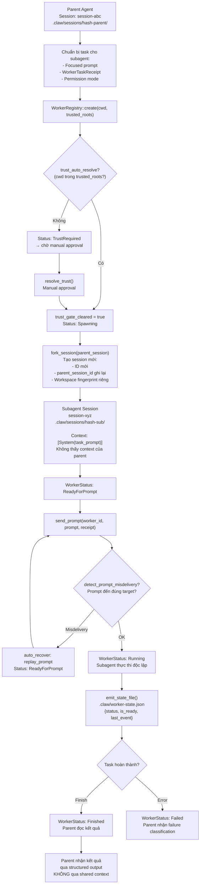

# Pattern 7 — Context-Isolated Subagents

> **Tóm tắt:** Mỗi subagent nhận một context window *hoàn toàn riêng biệt* — không chia sẻ lịch sử hội thoại với parent agent hay các subagent khác. Giao tiếp chỉ qua structured output (file, receipt), không qua shared memory.

---

## Vấn đề nó giải quyết

Nếu subagent chia sẻ context với parent:

- **Context bleed:** Subagent thấy toàn bộ lịch sử của parent → bị phân tán, xử lý thông tin không liên quan.
- **Noise amplification:** Mọi tool call, lỗi, thảo luận của parent đều inject vào context của subagent → token lãng phí, độ chính xác giảm.
- **Không thể parallelize:** Hai subagent cùng ghi vào một session → race condition, data corruption.

**Giải pháp:** Mỗi subagent có session file riêng, workspace fingerprint riêng. Parent chuẩn bị một prompt self-contained và "giao" cho subagent. Subagent không biết về parent — nó chỉ thấy prompt của nó và kết quả của các tool call của nó.

---

## Source code trong repo

| File | Vai trò |
|------|---------|
| [`session_control.rs:20–26`](../rust/crates/runtime/src/session_control.rs#L20) | `SessionStore` — namespace session theo workspace fingerprint |
| [`session_control.rs:296–303`](../rust/crates/runtime/src/session_control.rs#L296) | `workspace_fingerprint()` — FNV-1a hash tạo ID duy nhất per worktree |
| [`session_control.rs:174–196`](../rust/crates/runtime/src/session_control.rs#L174) | `fork_session()` — tạo session con với lineage từ session cha |
| [`worker_boot.rs:188–204`](../rust/crates/runtime/src/worker_boot.rs#L188) | `Worker` struct — đại diện một subagent instance |
| [`worker_boot.rs:28–37`](../rust/crates/runtime/src/worker_boot.rs#L28) | `WorkerStatus` — state machine: Spawning → Ready → Running → Finished |
| [`worker_boot.rs:166–174`](../rust/crates/runtime/src/worker_boot.rs#L166) | `WorkerTaskReceipt` — "contract" mô tả task subagent phải làm |
| [`worker_boot.rs:782–806`](../rust/crates/runtime/src/worker_boot.rs#L782) | `emit_state_file()` — ghi `worker-state.json` sau mỗi state transition |
| [`worker_boot.rs:207–263`](../rust/crates/runtime/src/worker_boot.rs#L207) | `WorkerRegistry::create()` — spawn worker mới với trust gate check |

---

## Mindset

Hãy nghĩ như Unix process model: khi bạn `fork()` một process, child nhận một *bản sao* của địa chỉ ảo tại thời điểm fork — sau đó hai process hoạt động hoàn toàn độc lập. Không có shared memory, không có channel ngầm.

Context-Isolated Subagent áp dụng nguyên tắc tương tự:

```
Parent session:     [user, assistant, tool, user, assistant, ...]  (100 messages)
                              │
                              │ fork_session() → copy + branch
                              ▼
Subagent session:   [System("Summarize this PR...")]               (1 message)
```

Subagent không thấy 100 messages của parent. Nó chỉ thấy đúng những gì parent gói vào trong prompt.

**"Isolation"** ở đây là hai lớp:
1. **Data isolation:** Session file khác nhau, namespace khác nhau.
2. **Context isolation:** Model chỉ nhận những gì thuộc session của nó.

---

## Diagram



---

## Technical walkthrough

### Bước 1 — Workspace fingerprint tạo namespace cứng

Mỗi subagent chạy trong một working directory riêng (worktree). `workspace_fingerprint()` hash canonical path này bằng FNV-1a 64-bit để tạo ID 16-char hex:

```rust
// session_control.rs:296-303
pub fn workspace_fingerprint(workspace_root: &Path) -> String {
    let input = workspace_root.to_string_lossy();
    let mut hash = 0xcbf2_9ce4_8422_2325_u64;  // FNV offset basis
    for byte in input.as_bytes() {
        hash ^= u64::from(*byte);
        hash = hash.wrapping_mul(0x0100_0000_01b3);  // FNV prime
    }
    format!("{hash:016x}")
}
```

Kết quả:
```
/tmp/worktree-alpha → a1b2c3d4e5f60718
/tmp/worktree-beta  → f9e8d7c6b5a40312
```

Session files sẽ nằm tại:
```
.claw/sessions/a1b2c3d4e5f60718/session-xxx.jsonl  ← subagent A
.claw/sessions/f9e8d7c6b5a40312/session-yyy.jsonl  ← subagent B
```

Hai subagent không bao giờ thấy session của nhau — ngay cả khi chạy song song.

---

### Bước 2 — Fork session với lineage

`fork_session()` tạo session con từ một session cha:

```
parent session:
  session_id = "session-abc"
  messages   = [100 messages]

fork_session(parent, branch_name = "fix-auth") →
  session_id        = "session-xyz" (mới)
  parent_session_id = "session-abc" (lưu lại lineage)
  branch_name       = "fix-auth"
  messages          = [] (TRỐNG — không kế thừa history)
  workspace_root    = store.workspace_root (workspace của subagent)
```

**Tại sao không copy messages?** Vì isolation là mục tiêu. Subagent nhận context qua `prompt`, không qua lịch sử shared.

**Lineage** (`parent_session_id`) chỉ dùng để audit/debug sau này — không ảnh hưởng đến context của subagent lúc chạy.

---

### Bước 3 — Worker lifecycle state machine

`Worker` đại diện cho một subagent instance. State machine:

```
Spawning
  │
  ├── trust prompt detected? → TrustRequired
  │                               │ resolve_trust() (manual / auto-allowlist)
  │                               ↓
  └──────────────────────── Spawning (trust cleared)
         │
         │ detect "ready for input" trên terminal
         ▼
  ReadyForPrompt
         │
         │ send_prompt(worker_id, prompt, receipt)
         ▼
  Running
         │
         ├── prompt misdelivery? → Failed / ReadyForPrompt (với replay_prompt)
         │
         ├── observe_completion("stop", tokens > 0) → Finished
         │
         └── observe_completion("unknown", 0 tokens) → Failed (provider degraded)
```

---

### Bước 4 — WorkerTaskReceipt: contract của subagent

Khi giao task cho subagent, parent định nghĩa một `WorkerTaskReceipt`:

```rust
WorkerTaskReceipt {
    repo: "claw-code",
    task_kind: "repo_code",
    source_surface: "omx_team",
    expected_artifacts: vec!["patch", "tests"],
    objective_preview: "Implement worker handshake",
}
```

Receipt này được dùng để **verify prompt delivery** — harness kiểm tra xem những từ khóa trong receipt có xuất hiện trên màn hình terminal của subagent không. Nếu subagent đang làm việc khác, harness phát hiện ra `WrongTask` misdelivery.

---

### Bước 5 — Misdelivery detection + auto-recovery

Sau khi gửi prompt, `observe(worker_id, screen_text)` phân tích màn hình terminal:

```
Vấn đề phổ biến với multi-agent:
  - Prompt gửi nhầm sang shell (shell misdelivery) → "command not found: Implement"
  - Prompt gửi sang wrong worktree → cwd không khớp
  - Prompt nhận bởi agent đang làm task khác → receipt không khớp
```

Nếu phát hiện misdelivery và `auto_recover_prompt_misdelivery = true`:
```
worker.replay_prompt = prompt  ← lưu lại prompt
worker.status = ReadyForPrompt ← reset để gửi lại
```

Lần `send_prompt` tiếp theo với `prompt = None` sẽ dùng `replay_prompt`:
```rust
let next_prompt = prompt
    .or_else(|| worker.replay_prompt.clone())  // dùng replay nếu không có prompt mới
    .ok_or("no prompt to send or replay")?;
```

---

### Bước 6 — Observability không cần shared context

Sau mỗi state transition, `emit_state_file()` ghi `worker-state.json` ra disk (atomic write via `.tmp` → `rename`):

```json
{
  "worker_id": "worker_67a3b2c1_5",
  "status": "running",
  "is_ready": false,
  "trust_gate_cleared": true,
  "prompt_in_flight": true,
  "last_event": { "kind": "running", "detail": "prompt dispatched" },
  "updated_at": 1745000000,
  "seconds_since_update": 3
}
```

**Tại sao file thay vì API?** External observers (clawhip, orchestrators) poll file này thay vì gọi HTTP endpoint. Điều này có nghĩa:
- Orchestrator không cần biết port của worker.
- Clawhip có thể monitor nhiều workers chỉ bằng cách watch file.
- Không có coupling giữa orchestrator và worker.

---

## Nếu bạn tự build

```python
# pseudo-code

import hashlib

def workspace_fingerprint(cwd: str) -> str:
    return hashlib.sha256(cwd.encode()).hexdigest()[:16]

class SubagentSession:
    def __init__(self, task_prompt: str, cwd: str, tools: list[str]):
        self.session_id = generate_id()
        self.cwd = cwd
        self.namespace = workspace_fingerprint(cwd)
        self.session_file = f".claw/sessions/{self.namespace}/{self.session_id}.jsonl"
        # Context bắt đầu TRỐNG — chỉ có task prompt
        self.messages = [{"role": "system", "content": task_prompt}]
        self.allowed_tools = tools  # tool set riêng, không kế thừa từ parent

    def run(self) -> str:
        while True:
            response = call_api(
                messages=self.messages,
                tools=self.allowed_tools
            )
            self.messages.append(response.message)
            self.persist()  # ghi vào session_file riêng

            if response.is_done():
                return extract_result(response)

            # Xử lý tool calls, append results, loop tiếp
            tool_results = execute_tools(response.tool_calls)
            self.messages.extend(tool_results)

class ParentAgent:
    def delegate_task(self, task: str, cwd: str) -> str:
        # 1. Chuẩn bị focused prompt
        prompt = f"You are a focused agent. Your only task: {task}\nDo not ask questions. Complete the task and return your findings."

        # 2. Tạo subagent với context RIÊNG
        subagent = SubagentSession(
            task_prompt=prompt,
            cwd=cwd,
            tools=["Read", "Grep", "Glob"]  # minimal tool set
        )

        # 3. Subagent chạy độc lập, parent không chia sẻ context
        result = subagent.run()

        # 4. Parent nhận kết quả qua return value — không qua shared memory
        return result
```

Quy tắc thiết kế:

| Rule | Lý do |
|------|-------|
| Subagent session TRỐNG khi khởi tạo | Isolation — không nhận lịch sử của parent |
| Prompt phải self-contained | Subagent không có context để hỏi lại |
| Namespace riêng per worktree | Parallel subagents không xung đột session file |
| Giao tiếp qua structured output | Không có shared memory → không có race condition |
| State file thay vì API | Orchestrator poll được mà không cần coupling |
| Lineage chỉ cho audit | `parent_session_id` không inject context vào subagent |

---

## Các cạm bẫy thường gặp

| Cạm bẫy | Hậu quả | Cách tránh |
|---------|---------|-----------|
| Truyền parent context vào subagent prompt | Subagent bị overload thông tin không liên quan | Prompt phải chỉ chứa những gì subagent cần để làm task |
| Dùng cùng session file cho parent và subagent | Race condition khi ghi, data corruption | Mỗi subagent dùng `workspace_fingerprint` riêng |
| Không verify prompt delivery | Prompt gửi nhầm sang shell / wrong agent → "thành công" trong khi thực ra không làm gì | Implement misdelivery detection với `WorkerTaskReceipt` |
| Subagent nhận quá nhiều tools | Subagent có thể vô tình modify state của parent | Tối thiểu hóa tool set theo đúng nhu cầu của task |
| Không timeout subagent | Subagent stuck → parent đợi mãi | Giới hạn thời gian, dùng `observe_startup_timeout()` để classify failure |
| Parent đọc kết quả từ shared memory | Coupling chặt, không safe với concurrent writes | Kết quả luôn qua structured output: file, receipt, return value |
