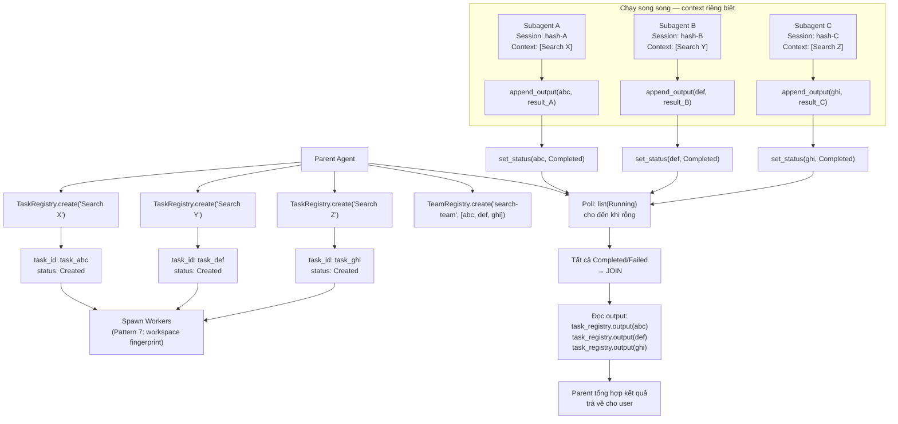

# Pattern 8 — Fork-Join Parallelism

> **Tóm tắt:** Nhiều subtask độc lập được dispatch song song (fork), mỗi task chạy như một subagent riêng. Parent theo dõi tiến trình qua registry chung và tổng hợp kết quả khi tất cả hoàn thành (join).

> **Liên hệ với Pattern 7:** Pattern 7 giải quyết *isolation* (mỗi subagent không thấy context của nhau). Pattern 8 giải quyết *coordination* (làm sao parent biết khi nào join, làm sao đọc kết quả). Hai pattern phối hợp: isolation đảm bảo an toàn, registry đảm bảo observability.

---

## Vấn đề nó giải quyết

Nếu xử lý 5 subtask tuần tự mất 5 phút, xử lý song song chỉ mất ~1 phút. Nhưng chạy song song đặt ra câu hỏi:

- Làm sao biết task nào đã xong, task nào còn đang chạy?
- Làm sao đọc kết quả mà không chia sẻ context window?
- Nếu một task fail, các task khác có tiếp tục không?
- Hai agent song song có race condition khi ghi vào cùng workspace không?

**Giải pháp:** Registry toàn cục, thread-safe (`OnceLock<Arc<Mutex<...>>>`) làm coordination plane. Parent đăng ký task, spawn subagents, poll registry cho đến khi tất cả về terminal state, rồi đọc output. Workspace fingerprinting (Pattern 7) đảm bảo không có race condition giữa các session file.

---

## Source code trong repo

| File | Vai trò |
|------|---------|
| [`tools/src/lib.rs:34–68`](../rust/crates/tools/src/lib.rs#L34) | 6 global `OnceLock` registries — shared coordination plane |
| [`task_registry.rs:34–46`](../rust/crates/runtime/src/task_registry.rs#L34) | `Task` struct — đơn vị theo dõi một subtask |
| [`task_registry.rs:14–20`](../rust/crates/runtime/src/task_registry.rs#L14) | `TaskStatus` — Created / Running / Completed / Failed / Stopped |
| [`task_registry.rs:73–120`](../rust/crates/runtime/src/task_registry.rs#L73) | `TaskRegistry::create()` — đăng ký task mới (fork) |
| [`task_registry.rs:175–192`](../rust/crates/runtime/src/task_registry.rs#L175) | `append_output()` — subagent stream kết quả về |
| [`task_registry.rs:127–135`](../rust/crates/runtime/src/task_registry.rs#L127) | `list(status_filter)` — parent poll để join |
| [`team_cron_registry.rs:50–82`](../rust/crates/runtime/src/team_cron_registry.rs#L50) | `TeamRegistry` / `Team` — nhóm task song song |
| [`session.rs:84–88`](../rust/crates/runtime/src/session.rs#L84) | Comment về phantom completions — lý do cần workspace fingerprint |

---

## Mindset

Hãy nghĩ như `Promise.all()` trong JavaScript hay `asyncio.gather()` trong Python — nhưng ở tầng agent:

```javascript
// JavaScript
const [result1, result2, result3] = await Promise.all([
    fetch("/api/1"),
    fetch("/api/2"),
    fetch("/api/3"),
]);

// Tương đương ở tầng agent
const [result1, result2, result3] = await AgentAll([
    SubAgent("Search codebase for X"),
    SubAgent("Search documentation for Y"),
    SubAgent("Search tests for Z"),
]);
```

Điểm khác biệt: mỗi "promise" là một *agent instance* với context riêng, không phải một HTTP request. Nhưng nguyên lý fork-join giống hệt nhau.

**Registry** là cơ chế thay thế cho shared memory: thay vì các agent chia sẻ context (nguy hiểm), chúng đọc/ghi qua một store trung gian thread-safe.

---

## Diagram



---

## Technical walkthrough

### Bước 1 — Global registries: coordination plane

`tools/src/lib.rs` định nghĩa 6 global singleton registries qua `OnceLock`:

```rust
fn global_task_registry() -> &'static TaskRegistry {
    static REGISTRY: OnceLock<TaskRegistry> = OnceLock::new();
    REGISTRY.get_or_init(TaskRegistry::new)
}

fn global_team_registry() -> &'static TeamRegistry {
    static REGISTRY: OnceLock<TeamRegistry> = OnceLock::new();
    REGISTRY.get_or_init(TeamRegistry::new)
}

fn global_worker_registry() -> &'static WorkerRegistry {
    static REGISTRY: OnceLock<WorkerRegistry> = OnceLock::new();
    REGISTRY.get_or_init(WorkerRegistry::new)
}
// + global_mcp_registry, global_lsp_registry, global_cron_registry
```

**Tại sao `OnceLock`?** Đảm bảo registry chỉ được khởi tạo một lần, dù có bao nhiêu thread gọi đồng thời. Sau lần đầu, mọi call đều nhận cùng một `&'static` reference — zero overhead, no allocation.

**Thread safety bên trong:** Mỗi registry dùng `Arc<Mutex<Inner>>`:
```rust
pub struct TaskRegistry {
    inner: Arc<Mutex<RegistryInner>>,
}
```
→ Nhiều subagent có thể gọi `append_output()` hay `set_status()` đồng thời mà không có race condition.

---

### Bước 2 — Fork: đăng ký và dispatch tasks

Parent tạo task entries trong `TaskRegistry` trước khi dispatch:

```
TaskRegistry.create("Search X in codebase", description = "sub-task 1")
  → Task { task_id: "task_abc", status: Created, output: "" }

TaskRegistry.create("Search Y in docs", description = "sub-task 2")
  → Task { task_id: "task_def", status: Created, output: "" }
```

Sau đó nhóm các task lại bằng `TeamRegistry`:

```
TeamRegistry.create("search-team", vec!["task_abc", "task_def"])
  → Team { team_id: "team_xyz", task_ids: [...], status: Created }
```

`Team` là một **fork group** — đơn vị để track "tất cả subtasks của một fork".

---

### Bước 3 — Phantom completions: tại sao cần workspace fingerprint

Comment quan trọng trong `session.rs:84`:

> *"The global session store under `~/.local/share/opencode` is shared across every `opencode serve` instance, so without an explicit workspace root parallel lanes can race and report success while writes land in the wrong CWD."* — ROADMAP #41

**Bug này xảy ra như thế nào:**

```
Subagent A (cwd: /repo-alpha) viết vào session file
Subagent B (cwd: /repo-beta)  viết vào cùng session file (!)
→ B báo "completed" nhưng output là của A
→ A nhận kết quả của B → "phantom completion"
```

**Fix:** `workspace_fingerprint()` (Pattern 7) tạo namespace riêng per worktree → session files không bao giờ trùng nhau dù chạy bao nhiêu agents song song.

```
/repo-alpha → hash a1b2... → sessions/a1b2.../session-A.jsonl
/repo-beta  → hash f9e8... → sessions/f9e8.../session-B.jsonl
```

---

### Bước 4 — Subagent stream kết quả về

Trong khi chạy, mỗi subagent gọi `append_output()` để stream kết quả vào registry:

```rust
// task_registry.rs:184-193
pub fn append_output(&self, task_id: &str, output: &str) -> Result<(), String> {
    let mut inner = self.inner.lock().expect("registry lock poisoned");
    let task = inner.tasks.get_mut(task_id)...;
    task.output.push_str(output);
    task.updated_at = now_secs();
    Ok(())
}
```

Subagent không cần biết parent đang đọc hay không — nó chỉ append vào `task.output`. Parent có thể đọc partial output bất cứ lúc nào (live streaming nếu cần).

---

### Bước 5 — Join: poll cho đến khi tất cả về terminal state

Parent poll `TaskRegistry` để biết khi nào join xong:

```rust
// Kiểm tra task còn running
let still_running = task_registry.list(Some(TaskStatus::Running));

// Join condition: không còn task nào đang running
if still_running.is_empty() {
    // Kiểm tra các task trong team
    let team = team_registry.get(team_id);
    let all_done = team.task_ids.iter()
        .map(|id| task_registry.get(id).map(|t| t.status))
        .all(|s| matches!(s, Some(Completed | Failed | Stopped)));
}
```

**Terminal states:** `Completed`, `Failed`, `Stopped` — một task ở terminal state sẽ không thay đổi nữa.

---

### Bước 6 — Synthesize: parent đọc và tổng hợp

Sau khi join, parent đọc output của từng task:

```rust
let result_a = task_registry.output("task_abc")?;
let result_b = task_registry.output("task_def")?;
let result_c = task_registry.output("task_ghi")?;

// Tổng hợp kết quả
let synthesis = synthesize_results(vec![result_a, result_b, result_c]);
```

Sau khi xong, `TeamRegistry.delete(team_id)` dọn dẹp.

---

## Nếu bạn tự build

```python
# pseudo-code

import threading
from dataclasses import dataclass, field
from enum import Enum

class TaskStatus(Enum):
    CREATED = "created"
    RUNNING = "running"
    COMPLETED = "completed"
    FAILED = "failed"

@dataclass
class Task:
    task_id: str
    prompt: str
    status: TaskStatus = TaskStatus.CREATED
    output: str = ""

class TaskRegistry:
    def __init__(self):
        self._tasks = {}
        self._lock = threading.Lock()

    def create(self, prompt: str) -> Task:
        with self._lock:
            task_id = generate_id()
            task = Task(task_id=task_id, prompt=prompt)
            self._tasks[task_id] = task
            return task

    def append_output(self, task_id: str, output: str):
        with self._lock:
            self._tasks[task_id].output += output

    def set_status(self, task_id: str, status: TaskStatus):
        with self._lock:
            self._tasks[task_id].status = status

    def get_output(self, task_id: str) -> str:
        with self._lock:
            return self._tasks[task_id].output

    def all_done(self, task_ids: list[str]) -> bool:
        terminal = {TaskStatus.COMPLETED, TaskStatus.FAILED}
        with self._lock:
            return all(self._tasks[tid].status in terminal for tid in task_ids)

# Singleton (OnceLock equivalent)
_task_registry = None
def global_task_registry() -> TaskRegistry:
    global _task_registry
    if _task_registry is None:
        _task_registry = TaskRegistry()
    return _task_registry

def fork_join(tasks: list[str]) -> list[str]:
    registry = global_task_registry()
    task_ids = []

    # Fork: đăng ký tất cả tasks
    for prompt in tasks:
        task = registry.create(prompt)
        task_ids.append(task.task_id)

    # Spawn subagents trong threads riêng (hoặc async)
    threads = []
    for i, task_id in enumerate(task_ids):
        def run_subagent(tid, p):
            registry.set_status(tid, TaskStatus.RUNNING)
            result = SubagentSession(
                task_prompt=p,
                cwd=f"/worktrees/agent-{tid}"  # workspace riêng (Pattern 7)
            ).run()
            registry.append_output(tid, result)
            registry.set_status(tid, TaskStatus.COMPLETED)
        t = threading.Thread(target=run_subagent, args=(task_id, tasks[i]))
        t.start()
        threads.append(t)

    # Join: đợi tất cả xong
    for t in threads:
        t.join()

    # Collect results
    return [registry.get_output(tid) for tid in task_ids]
```

Quy tắc thiết kế:

| Rule | Lý do |
|------|-------|
| Registry là coordination plane, không phải shared context | Context sharing nguy hiểm; registry thread-safe và không gây context bleed |
| `OnceLock` cho singleton | Initialization thread-safe, zero overhead sau lần đầu |
| Tasks phải thực sự độc lập | Nếu task B cần output của task A → chúng không thể song song |
| Workspace fingerprint riêng per subagent | Tránh phantom completions — race condition nguy hiểm nhất trong multi-agent |
| Stream output qua `append_output()` | Parent có thể đọc partial results, không cần đợi full completion |
| `Team` nhóm các task liên quan | Dễ cleanup sau join; biết task nào thuộc fork group nào |

---

## Các cạm bẫy thường gặp

| Cạm bẫy | Hậu quả | Cách tránh |
|---------|---------|-----------|
| Các task có dependency lẫn nhau | Task B dùng output chưa có của task A → incorrect results | Chỉ fork khi tasks thực sự độc lập; sequential nếu có dependency |
| Không có workspace fingerprint | Phantom completions — agent B báo success với output của A | Mỗi subagent dùng worktree riêng + `workspace_fingerprint()` |
| Join bằng cách check global status | Nếu registry chứa tasks từ session khác → join quá sớm | Check theo `team_id` (task_ids của đúng fork group), không phải toàn bộ registry |
| Không handle partial failures | Một task fail → kết quả của các task còn lại bị bỏ qua | Join logic phải xử lý cả `Completed` lẫn `Failed`; tổng hợp với missing data |
| Unbounded parallelism | 100 agents chạy song song → rate limit API, quota exhaustion | Semaphore hoặc batching để giới hạn số agents đồng thời |
| Registry không được dọn dẹp | Task entries tích lũy vô hạn → memory leak | `TeamRegistry.delete()` sau khi join xong |
