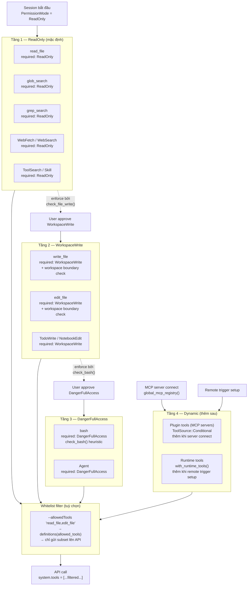

# Pattern 9 — Progressive Tool Expansion

> **Tóm tắt:** Agent không nhận toàn bộ tool set ngay từ đầu — tools được "mở khoá" theo từng tầng permission. ReadOnly → WorkspaceWrite → DangerFullAccess → plugin tools (MCP) → runtime tools. Mỗi tầng mở ra thêm khả năng, nhưng cũng thêm trách nhiệm.

---

## Vấn đề nó giải quyết

Nếu agent có tất cả tools từ đầu (bao gồm `bash`, `write_file`):

- Model có thể gọi `bash("rm -rf /")` bất cứ lúc nào — không có safety gate nào.
- Không có cách nào enforce "đọc trước khi viết" ở tầng infrastructure.
- MCP tool không an toàn sẽ khả dụng ngay từ đầu session.

**Giải pháp:** Phân tầng tool set theo permission mode. Ở mỗi tầng, chỉ những tools phù hợp mới được gửi lên model trong API call. Model không thể gọi tool nó không biết tồn tại.

---

## Source code trong repo

| File | Vai trò |
|------|---------|
| [`tools/src/lib.rs:385–620`](../rust/crates/tools/src/lib.rs#L385) | `mvp_tool_specs()` — danh sách tool + `required_permission` của từng tool |
| [`tools/src/lib.rs:78–81`](../rust/crates/tools/src/lib.rs#L78) | `ToolSource::Base` / `Conditional` — phân loại tool tĩnh vs động |
| [`tools/src/lib.rs:246–278`](../rust/crates/tools/src/lib.rs#L246) | `definitions(allowed_tools)` — filter tool set trước khi gửi lên API |
| [`tools/src/lib.rs:159–184`](../rust/crates/tools/src/lib.rs#L159) | `with_runtime_tools()` — thêm tool động (MCP, remote triggers) |
| [`permission_enforcer.rs:14–24`](../rust/crates/runtime/src/permission_enforcer.rs#L14) | `EnforcementResult` — `Allowed` / `Denied` với context đầy đủ |
| [`permission_enforcer.rs:39–60`](../rust/crates/runtime/src/permission_enforcer.rs#L39) | `check()` — kiểm tra generic tool |
| [`permission_enforcer.rs:108–142`](../rust/crates/runtime/src/permission_enforcer.rs#L108) | `check_file_write()` — kiểm tra write + workspace boundary |
| [`permission_enforcer.rs:145–173`](../rust/crates/runtime/src/permission_enforcer.rs#L145) | `check_bash()` — kiểm tra bash với read-only heuristic |
| [`permission_enforcer.rs:70–100`](../rust/crates/runtime/src/permission_enforcer.rs#L70) | `check_with_required_mode()` — kiểm tra với mode động (dùng bởi Pattern 10) |
| [`permission_enforcer.rs:194–272`](../rust/crates/runtime/src/permission_enforcer.rs#L194) | `is_read_only_command()` — heuristic 50+ read-only commands |

---

## Mindset

Hãy nghĩ như privilege escalation trong Unix: bạn bắt đầu với user thường, dùng `sudo` để leo lên root khi cần. Không phải vì bạn không đủ tin tưởng — mà vì **blast radius của lỗi phụ thuộc vào quyền hạn tại thời điểm lỗi xảy ra**.

```
Session bắt đầu với ReadOnly:
  → Tệ nhất nếu model bị confuse: nó đọc file không liên quan. Vô hại.

Session có WorkspaceWrite:
  → Tệ nhất: nó overwrite file. Recoverable với git.

Session có DangerFullAccess:
  → Tệ nhất: nó chạy shell command xoá data. Possibly irreversible.
```

**Progressive expansion** đảm bảo: blast radius khi lỗi bị giới hạn bởi tầng permission đang active, không phải bởi toàn bộ capability của hệ thống.

---

## Diagram



---

## Technical walkthrough

### Bước 1 — Tool manifest: mỗi tool có `required_permission`

`mvp_tool_specs()` định nghĩa toàn bộ base tool set, mỗi tool kèm `required_permission`:

```
Tool          │ required_permission
──────────────┼─────────────────────
read_file     │ ReadOnly
glob_search   │ ReadOnly
grep_search   │ ReadOnly
WebFetch      │ ReadOnly
WebSearch     │ ReadOnly
ToolSearch    │ ReadOnly
Skill         │ ReadOnly
──────────────┼─────────────────────
write_file    │ WorkspaceWrite
edit_file     │ WorkspaceWrite
TodoWrite     │ WorkspaceWrite
NotebookEdit  │ WorkspaceWrite
──────────────┼─────────────────────
bash          │ DangerFullAccess
Agent         │ DangerFullAccess
```

Mỗi tool cũng khai báo `input_schema` JSON Schema để validate input trước khi execute.

---

### Bước 2 — `EnforcementResult`: kết quả rõ ràng, có context

`PermissionEnforcer.check()` trả về `EnforcementResult` với context đầy đủ:

```rust
// Allowed
EnforcementResult::Allowed

// Denied — model nhận được message rõ ràng
EnforcementResult::Denied {
    tool: "write_file",
    active_mode: "read-only",
    required_mode: "workspace-write",
    reason: "tool 'write_file' requires workspace-write permission; current mode is read-only",
}
```

Tại sao không chỉ `true/false`? Vì model cần context để quyết định bước tiếp theo: *"Tôi cần WorkspaceWrite — đề xuất user approve trước khi tiếp tục."*

---

### Bước 3 — Ba specialization của `check()`

**`check(tool_name, input)`** — generic: tra cứu `required_permission` trong `tool_requirements` map, so với `active_mode`.

**`check_file_write(path, workspace_root)`** — thêm kiểm tra **workspace boundary**:

```rust
match mode {
    ReadOnly        => Denied  (file writes không được phép)
    WorkspaceWrite  => nếu path trong workspace → Allowed
                       nếu path ngoài workspace → Denied (cần DangerFullAccess)
    DangerFullAccess | Allow => Allowed (ghi bất cứ đâu)
    Prompt          => Denied (cần confirmation)
}
```

Đây là một chi tiết quan trọng: `WorkspaceWrite` không có nghĩa là *"viết bất cứ đâu"* — nó có nghĩa là *"viết trong workspace"*. Ghi ra ngoài workspace (ví dụ `/etc/passwd`) đòi hỏi `DangerFullAccess`.

**`check_bash(command)`** — đặc biệt nhất, kết hợp với heuristic:

```rust
match mode {
    ReadOnly  => nếu is_read_only_command(command) → Allowed
                 ngược lại → Denied
    Prompt    → Denied (cần confirmation)
    _         → Allowed
}
```

---

### Bước 4 — `is_read_only_command()`: conservative heuristic

Với `ReadOnly` mode, một số bash commands vẫn được phép nếu chúng read-only. Heuristic này check first token + absence of dangerous flags:

```
Allowed: cat, head, tail, ls, find, grep, rg, git, gh, cargo, python3, ...
         (50+ commands)

Block nếu có:
  -i / --in-place   (sed -i, python -i — modifies in place)
   > / >>            (output redirect — ghi file)
```

Ví dụ:
```
"cat src/main.rs"          → Allowed (read-only)
"grep -r 'pattern' ."      → Allowed
"git log --oneline"         → Allowed
"git push"                  → Allowed (!) → sẽ bị Pattern 10 classify là Warn
"cat file > out.txt"        → Denied (có redirect)
"sed -i 's/a/b/' file"     → Denied (-i flag)
"rm -rf /"                  → Denied (rm không trong whitelist)
```

---

### Bước 5 — `check_with_required_mode()`: tích hợp với Pattern 10

Pattern 10 (Command Risk Classification) sẽ phân loại bash command thành các intent levels. Kết quả đó được đưa vào `check_with_required_mode()`:

```rust
pub fn check_with_required_mode(
    &self, tool_name: &str, input: &str, required_mode: PermissionMode
) -> EnforcementResult {
    if self.policy.active_mode() == PermissionMode::Prompt {
        return EnforcementResult::Allowed;  // defer to caller's interactive flow
    }

    let active_mode = self.policy.active_mode();
    if active_mode >= required_mode {
        EnforcementResult::Allowed
    } else {
        EnforcementResult::Denied { ... }
    }
}
```

Đây là điểm tích hợp: Pattern 10 quyết định `required_mode` từ nội dung command; Pattern 9 quyết định `active_mode` từ session config. Cả hai cùng gate một bash call.

---

### Bước 6 — Dynamic expansion: Plugin tools và Runtime tools

Ngoài base tools, `GlobalToolRegistry` có thể mở rộng:

**Plugin tools (MCP servers):**
```rust
GlobalToolRegistry::with_plugin_tools(plugin_tools)
// Validate: không trùng tên với built-in tools
// Không trùng tên với nhau
```

Plugin tools có `ToolSource::Conditional` — chúng xuất hiện trong tool manifest chỉ khi MCP server đã connect. Model không thấy chúng nếu server chưa sẵn sàng.

**Runtime tools:**
```rust
registry.with_runtime_tools(runtime_tools)
// Thêm remote trigger tools, scheduled task tools, etc.
```

---

### Bước 7 — `allowed_tools` whitelist: tầng lọc thêm

Ngoài permission mode, user có thể restrict tool set bằng `--allowedTools`:

```bash
claw --allowedTools "read_file,edit_file,grep_search"
```

`definitions(allowed_tools)` filter tool list trước khi gửi lên API:

```rust
builtin.filter(|spec| allowed_tools.is_none_or(|allowed| allowed.contains(spec.name)))
```

Kết quả: model chỉ thấy 3 tools trong `system.tools` — không thể gọi `bash` dù session ở DangerFullAccess mode.

**Alias support:** `"read"` → `"read_file"`, `"edit"` → `"edit_file"`, etc. để tiện gõ.

---

## Nếu bạn tự build

```python
# pseudo-code

TOOL_PERMISSIONS = {
    "read_file":   "read-only",
    "glob_search": "read-only",
    "grep_search": "read-only",
    "WebFetch":    "read-only",
    "write_file":  "workspace-write",
    "edit_file":   "workspace-write",
    "bash":        "danger-full-access",
}

MODE_LEVEL = {
    "read-only":         0,
    "workspace-write":   1,
    "danger-full-access": 2,
    "allow":             3,
}

def check_tool(tool_name: str, active_mode: str, workspace_root: str = None,
               path: str = None, command: str = None) -> EnforcementResult:

    required = TOOL_PERMISSIONS.get(tool_name, "danger-full-access")

    # Special: bash trong read-only có thể pass nếu command read-only
    if tool_name == "bash" and active_mode == "read-only":
        if is_read_only_command(command):
            return EnforcementResult(allowed=True)

    # Special: workspace boundary check
    if tool_name in ("write_file", "edit_file") and active_mode == "workspace-write":
        if path and not path.startswith(workspace_root):
            return EnforcementResult(
                allowed=False,
                required="danger-full-access",
                reason=f"path '{path}' is outside workspace"
            )

    # Generic mode check
    if MODE_LEVEL[active_mode] >= MODE_LEVEL[required]:
        return EnforcementResult(allowed=True)

    return EnforcementResult(
        allowed=False,
        active_mode=active_mode,
        required_mode=required,
        reason=f"'{tool_name}' requires '{required}'; current: '{active_mode}'"
    )

def get_available_tools(active_mode: str, allowed_tools: list[str] = None,
                        plugin_tools: list = None) -> list[ToolDefinition]:
    tools = [
        t for t in ALL_TOOL_SPECS
        if MODE_LEVEL[active_mode] >= MODE_LEVEL[TOOL_PERMISSIONS[t.name]]
    ]
    # Thêm plugin tools nếu MCP đã connect
    if plugin_tools:
        tools.extend(plugin_tools)

    # Whitelist filter
    if allowed_tools:
        tools = [t for t in tools if t.name in allowed_tools]

    return tools
```

Quy tắc thiết kế:

| Rule | Lý do |
|------|-------|
| Mỗi tool có `required_permission` tĩnh | Rõ ràng, dễ audit — không cần đọc code để biết tool cần quyền gì |
| `WorkspaceWrite` có workspace boundary check | File write trong workspace là safe; ngoài workspace là destructive |
| Bash heuristic theo whitelist, không blacklist | Whitelist safe — unknown command → denied, không phải allowed |
| Dynamic tools thêm sau, không phải từ đầu | MCP tool có thể untrusted → cần connect/validate trước khi expose |
| `EnforcementResult` có đủ context cho model | Model không chỉ biết "denied" mà còn biết "tại sao" và "cần gì" |
| `allowed_tools` whitelist độc lập với mode | Hai tầng lọc orthogonal → defense in depth |

---

## Các cạm bẫy thường gặp

| Cạm bẫy | Hậu quả | Cách tránh |
|---------|---------|-----------|
| Default tool set = DangerFullAccess | Blast radius tối đa ngay từ turn đầu | Bắt đầu ReadOnly; escalate khi có lý do cụ thể |
| Unknown tool mặc định allowed | Attacker inject MCP tool có thể chạy ngay | Unknown tool phải default-deny (yêu cầu DangerFullAccess) |
| Bash heuristic dùng blacklist | "Nguy hiểm mới biết" — không bao giờ đầy đủ | Dùng whitelist: chỉ những command đã biết safe mới được pass |
| Không check workspace boundary | `WorkspaceWrite` cho phép ghi `/etc/shadow` | `check_file_write()` phải verify path prefix |
| `Denied` không có context | Model không biết cần làm gì → thử lại vô nghĩa | `EnforcementResult::Denied` phải có `active_mode`, `required_mode`, `reason` |
| Plugin tools không validate tên | MCP tool đặt tên `read_file` → shadow built-in | `with_plugin_tools()` phải reject conflict với built-in names |
