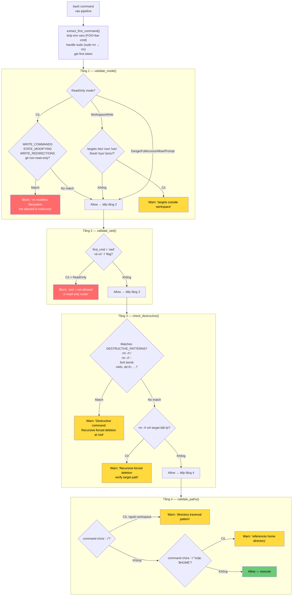

# Pattern 10 — Command Risk Classification

> **Tóm tắt:** Mỗi bash command được đưa qua một pipeline 4 tầng trước khi execute. Kết quả là một trong ba quyết định: `Allow` (chạy ngay), `Warn` (hiện cảnh báo, hỏi user), hoặc `Block` (từ chối kèm lý do). Không có "execute blindly".

---

## Vấn đề nó giải quyết

`bash` là tool mạnh nhất — nhưng cũng nguy hiểm nhất. Tất cả shell commands đều là "gọi bash", nhưng `ls -la` và `rm -rf /` không thể được đối xử giống nhau.

Nếu không phân loại:

- `rm -rf ~` trong `WorkspaceWrite` mode sẽ xóa home directory mà không có cảnh báo.
- `git push --force` trong `ReadOnly` mode sẽ vẫn chạy nếu không có gate.
- `:(){ :|:& };:` (fork bomb) sẽ crash hệ thống.

**Giải pháp:** Pipeline 4 tầng phân loại risk trước khi execute, áp dụng chính sách phù hợp với từng tầng risk.

---

## Source code trong repo

| File | Vai trò |
|------|---------|
| [`bash_validation.rs:17–24`](../rust/crates/runtime/src/bash_validation.rs#L17) | `ValidationResult` — 3 outcomes: Allow / Block / Warn |
| [`bash_validation.rs:28–45`](../rust/crates/runtime/src/bash_validation.rs#L28) | `CommandIntent` — 8 semantic categories |
| [`bash_validation.rs:594–615`](../rust/crates/runtime/src/bash_validation.rs#L594) | `validate_command()` — pipeline chính, 4 tầng |
| [`bash_validation.rs:103–160`](../rust/crates/runtime/src/bash_validation.rs#L103) | `validate_read_only()` — tầng 1: block writes trong ReadOnly mode |
| [`bash_validation.rs:336–350`](../rust/crates/runtime/src/bash_validation.rs#L336) | `validate_sed()` — tầng 2: validate `-i` flag |
| [`bash_validation.rs:241–273`](../rust/crates/runtime/src/bash_validation.rs#L241) | `check_destructive()` — tầng 3: warn destructive patterns |
| [`bash_validation.rs:360–382`](../rust/crates/runtime/src/bash_validation.rs#L360) | `validate_paths()` — tầng 4: detect path traversal |
| [`bash_validation.rs:533–583`](../rust/crates/runtime/src/bash_validation.rs#L533) | `classify_command()` — semantic classifier → `CommandIntent` |
| [`bash_validation.rs:622–676`](../rust/crates/runtime/src/bash_validation.rs#L622) | `extract_first_command()` — strip env vars, handle sudo |

---

## Mindset

Hãy nghĩ như kiểm soát viên sân bay: không phải tất cả hành khách đều nguy hiểm, nhưng không thể để tất cả đi qua mà không kiểm tra. Hệ thống phân loại thành:

```
Green (Allow): safe, chạy ngay — ls, cat, git status
Yellow (Warn): có thể nguy hiểm — hỏi trước khi chạy — rm -rf .
Red (Block): không được phép trong context hiện tại — rm trong ReadOnly mode
```

**Tại sao cần Warn thay vì chỉ Allow/Block?** Vì một số commands vừa có thể hợp lệ vừa có thể nguy hiểm tùy context. `rm -rf /tmp/old-build` hoàn toàn ổn. `rm -rf ~` là catastrophic. Không thể phân biệt statically → Warn yêu cầu human confirmation.

---

## Diagram



---

## Technical walkthrough

### Bước 1 — `extract_first_command()`: parse trước khi classify

Trước khi classify, cần lấy đúng "tên command thực sự". Hai edge case quan trọng:

**1. Leading environment variables:**
```
"FOO=bar rm -rf /" → trích xuất "rm"
"A=1 B=2 echo hello" → trích xuất "echo"
```
Code scan `KEY=value` prefix patterns (alphanumeric + underscore, không có space), skip qua để lấy command thực sự.

**2. sudo wrapping:**
```
"sudo rm -rf /tmp/x" → first_command = "sudo" → extract_sudo_inner() → "rm -rf /tmp/x"
→ validate_read_only("rm -rf /tmp/x", ...) → Block
```
`sudo` không bypass bất kỳ validation nào — command bên trong được validate riêng.

---

### Bước 2 — Tầng 1: `validate_read_only()` — mode-aware blocking

Tầng quan trọng nhất. Chỉ active trong `ReadOnly` mode.

**WRITE_COMMANDS** (bị block trong ReadOnly):
```
cp, mv, rm, mkdir, rmdir, touch, chmod, chown, chgrp, ln,
install, tee, truncate, shred, mkfifo, mknod, dd
```

**STATE_MODIFYING_COMMANDS** (bị block trong ReadOnly):
```
apt, brew, pip, npm, yarn, cargo, docker, systemctl,
kill, pkill, reboot, shutdown, useradd, crontab, ...
```

**Write redirections** bị block: `>`, `>>`, `>&`

**Git special-casing** — không phải mọi `git` đều như nhau:
```
GIT_READ_ONLY_SUBCOMMANDS = [status, log, diff, show, branch, tag,
                               stash, remote, fetch, ls-files, blame, ...]

git status    → Allow  (read-only subcommand)
git log       → Allow
git push      → Block  ("push modifies repository state")
git commit    → Block
git checkout  → Block
```

`WorkspaceWrite` mode: block ghi vào system paths (`/etc/`, `/usr/`, `/var/`, `/boot/`, `/sys/`, `/proc/`, `/dev/`, `/sbin/`, `/lib/`, `/opt/`).

---

### Bước 3 — Tầng 2: `validate_sed()`

`sed` có thể vừa read-only (print to stdout) vừa destructive (in-place editing):

```
sed 's/old/new/' file.txt    → đọc và in ra stdout → ReadOnly intent
sed -i 's/old/new/' file.txt → sửa file tại chỗ   → Write intent
```

Tầng này chuyên xử lý edge case này:
```
ReadOnly + sed -i → Block: "sed -i not allowed in read-only mode"
WorkspaceWrite + sed -i → Allow (sẽ bị classify là Write intent bởi classifier)
```

---

### Bước 4 — Tầng 3: `check_destructive()` — pattern-based Warn

Tầng này không Block — nó chỉ Warn. Vì những commands này *có thể* hợp lệ, nhưng cần human verification.

**DESTRUCTIVE_PATTERNS** (Warn với message cụ thể):
```
Pattern                    Message
"rm -rf /"               → "Recursive forced deletion at root — this will destroy the system"
"rm -rf ~"               → "Recursive forced deletion of home directory"
"rm -rf *"               → "Recursive forced deletion of all files in current directory"
"rm -rf ."               → "Recursive forced deletion of current directory"
"mkfs"                   → "Filesystem creation will destroy existing data"
"dd if="                 → "Direct disk write — can overwrite partitions"
"> /dev/sd"              → "Writing to raw disk device"
"chmod -R 777"           → "Recursively setting world-writable permissions"
":(){ :|:& };:"          → "Fork bomb — will crash the system"
```

**ALWAYS_DESTRUCTIVE_COMMANDS**: `shred`, `wipefs` — không cần check arguments.

**Fallback**: bất kỳ `rm -rf` nào chưa match pattern trên → Warn generic message.

---

### Bước 5 — Tầng 4: `validate_paths()` — path traversal detection

```
"../../../etc/passwd"  → Warn: "directory traversal pattern"
"~/.ssh/id_rsa"        → Warn: "references home directory"
"$HOME/.aws/config"    → Warn: "references home directory"
```

Heuristic cho `../`: nếu workspace path không xuất hiện trong command → có thể escape workspace → Warn.

---

### Bước 6 — `classify_command()`: semantic layer

Ngoài pipeline validation, `classify_command()` trả về `CommandIntent` — metadata về *ý nghĩa* của command:

```
ls, cat, grep, find, diff, git status  → ReadOnly
cp, mv, mkdir, tee, git push           → Write
rm, shred, wipefs                      → Destructive
curl, wget, ssh, ping                  → Network
kill, pkill, ps                        → ProcessManagement
apt, npm, cargo, pip                   → PackageManagement
sudo, chmod, mount, systemctl          → SystemAdmin
(unknown)                              → Unknown
```

`CommandIntent` được dùng bởi Pattern 9 (`check_with_required_mode()`) để map intent → `PermissionMode`:

```
ReadOnly     → PermissionMode::ReadOnly
Write        → PermissionMode::WorkspaceWrite
Destructive  → PermissionMode::DangerFullAccess
Network      → PermissionMode::WorkspaceWrite (thường)
SystemAdmin  → PermissionMode::DangerFullAccess
Unknown      → PermissionMode::DangerFullAccess (default-deny)
```

---

### Tổng hợp: pipeline short-circuit

`validate_command()` chạy 4 tầng theo thứ tự, **dừng ở tầng đầu tiên không phải Allow**:

```rust
pub fn validate_command(command: &str, mode: PermissionMode, workspace: &Path) -> ValidationResult {
    // 1. Mode validation (bao gồm read-only checks)
    let result = validate_mode(command, mode);
    if result != Allow { return result; }  // Block → dừng ngay

    // 2. Sed validation
    let result = validate_sed(command, mode);
    if result != Allow { return result; }  // Block → dừng

    // 3. Destructive warning
    let result = check_destructive(command);
    if result != Allow { return result; }  // Warn → dừng

    // 4. Path validation
    validate_paths(command, workspace)     // Warn hoặc Allow
}
```

**Short-circuit có ý nghĩa gì?** Nếu mode Block command (tầng 1), không cần check destructive patterns (tầng 3) — đỡ tốn compute và tránh noise message.

---

## Nếu bạn tự build

```python
# pseudo-code

WRITE_COMMANDS = {"cp", "mv", "rm", "mkdir", "touch", "chmod", "tee", "truncate", ...}
STATE_MODIFYING = {"apt", "npm", "pip", "docker", "kill", "systemctl", ...}
DESTRUCTIVE_PATTERNS = [
    ("rm -rf /",  "Recursive forced deletion at root"),
    ("rm -rf ~",  "Recursive forced deletion of home directory"),
    ("mkfs",      "Filesystem creation destroys data"),
    (":(){ :|:& };:", "Fork bomb — will crash the system"),
]
GIT_READ_ONLY = {"status", "log", "diff", "show", "branch", "blame", ...}

def validate_command(command: str, mode: str, workspace: str) -> ValidationResult:
    first = extract_first_command(command)

    # Tầng 1: mode validation
    if mode == "read-only":
        if first in WRITE_COMMANDS or first in STATE_MODIFYING:
            return Block(f"'{first}' modifies state; not allowed in read-only mode")
        if ">" in command or ">>" in command:
            return Block("write redirection not allowed in read-only mode")
        if first == "git":
            sub = extract_git_subcommand(command)
            if sub not in GIT_READ_ONLY:
                return Block(f"git {sub} modifies repository; not allowed in read-only mode")
        if first == "sudo":
            inner = extract_sudo_inner(command)
            inner_result = validate_command(inner, mode, workspace)
            if inner_result != Allow: return inner_result
    elif mode == "workspace-write":
        if first in WRITE_COMMANDS and any(sys in command for sys in ["/etc/", "/usr/", "/var/"]):
            return Warn("command targets files outside workspace")

    # Tầng 2: sed -i
    if first == "sed" and "-i" in command and mode == "read-only":
        return Block("sed -i not allowed in read-only mode")

    # Tầng 3: destructive patterns
    for pattern, message in DESTRUCTIVE_PATTERNS:
        if pattern in command:
            return Warn(f"Destructive command detected: {message}")
    if "rm" in first and "-r" in command and "-f" in command:
        return Warn("Recursive forced deletion — verify target path")

    # Tầng 4: path traversal
    if "../" in command and workspace not in command:
        return Warn("Directory traversal '../' — verify path resolves within workspace")
    if "~/" in command or "$HOME" in command:
        return Warn("References home directory — verify stays in workspace scope")

    return Allow()

def classify_command(command: str) -> CommandIntent:
    first = extract_first_command(command)
    if first in SEMANTIC_READ_ONLY: return ReadOnly
    if first in WRITE_COMMANDS: return Write
    if first == "rm" or first in {"shred", "wipefs"}: return Destructive
    if first in NETWORK_COMMANDS: return Network
    if first in SYSTEM_ADMIN_COMMANDS: return SystemAdmin
    if first in PACKAGE_COMMANDS: return PackageManagement
    if first == "git":
        sub = extract_git_subcommand(command)
        return ReadOnly if sub in GIT_READ_ONLY else Write
    return Unknown  # default-deny ở tầng permission
```

Quy tắc thiết kế:

| Rule | Lý do |
|------|-------|
| 3 outcomes (Allow/Warn/Block), không phải 2 | Warn cho phép human confirmation thay vì hard deny |
| Pipeline short-circuit ở tầng đầu tiên | Không generate noise message khi đã Block từ tầng 1 |
| Tầng 1 Block, tầng 3-4 chỉ Warn | Block là "không bao giờ được phép"; Warn là "hỏi user" |
| git được special-case | `git` có cả read-only và write subcommands trong cùng một binary |
| sudo unwrapping đệ quy | `sudo rm` phải được validate như `rm` |
| `Unknown` intent → `DangerFullAccess` required | Default-deny: lệnh không biết → đòi hỏi quyền cao nhất |

---

## Các cạm bẫy thường gặp

| Cạm bẫy | Hậu quả | Cách tránh |
|---------|---------|-----------|
| Chỉ check first token, bỏ qua env var prefix | `FOO=bar rm file` bypass → chạy như AllowList | `extract_first_command()` phải strip env vars trước |
| Không unwrap sudo | `sudo rm -rf /` bypass ReadOnly check | Recursive validate inner command của sudo |
| Dùng blacklist thay vì whitelist cho read-only | Unknown command được phép → nguy hiểm | Chỉ allow những command đã biết safe |
| Không special-case git | `git push` được phép trong ReadOnly | Git cần check subcommand, không phải chỉ `git` |
| Tầng destructive Block thay vì Warn | `rm -rf /tmp/build` bị block dù hợp lệ | Destructive commands Warn → human decide, không Block |
| Không có path traversal check | `cat ../../../etc/passwd` chạy được | Validate `../` và `~/` trong command string |
