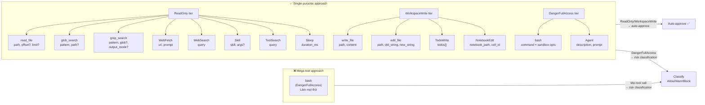

# Pattern 11 — Single-Purpose Tool Design

> **Tóm tắt:** Thay vì một mega-tool duy nhất (bash làm mọi thứ), harness cung cấp nhiều tool nhỏ với *narrow contract*: mỗi tool làm đúng một việc, có input/output schema cụ thể, và yêu cầu permission tối thiểu cần thiết. Càng hẹp contract, càng dễ auto-approve an toàn.

---

## Vấn đề nó giải quyết

Nếu chỉ có tool `bash`, model sẽ dùng bash cho mọi thứ:

```bash
# Model dùng bash để đọc file
bash("cat src/main.rs")

# Model dùng bash để tìm kiếm
bash("grep -r 'TODO' src/")

# Model dùng bash để list file
bash("ls -la")
```

Kết quả:
- **Permission phải cao nhất:** Bash là `DangerFullAccess` — harness không thể biết trước `cat` hay `rm -rf /` sẽ được gõ vào.
- **Không thể auto-approve:** Mọi bash call đều phải qua risk classification (Pattern 10) — overhead lớn.
- **Không có structured output:** `cat file.txt` trả về string thô. `read_file(path)` trả về `{ content, num_lines, start_line, total_lines }` — model có thêm metadata hữu ích.
- **Không có safety boundary:** Bash không biết workspace root là gì. `read_file` từ chối đọc binary, giới hạn 10MB, trả lỗi có ý nghĩa.

**Giải pháp:** Thiết kế mỗi tool như một small function với contract rõ ràng. Model tự nhiên chọn tool phù hợp — ít bash hơn, ít risk classification hơn, ít overhead hơn.

---

## Source code trong repo

| File | Vai trò |
|------|---------|
| [`tools/src/lib.rs:71–75`](../rust/crates/tools/src/lib.rs#L71) | `ToolManifestEntry` + `ToolSource` enum |
| [`tools/src/lib.rs:100–106`](../rust/crates/tools/src/lib.rs#L100) | `ToolSpec` — struct định nghĩa một tool |
| [`tools/src/lib.rs:385–631`](../rust/crates/tools/src/lib.rs#L385) | `mvp_tool_specs()` — manifest toàn bộ 15 tools |
| [`tools/src/lib.rs:246–278`](../rust/crates/tools/src/lib.rs#L246) | `definitions(allowed_tools)` — filter tools trước khi gửi API |
| [`tools/src/lib.rs:192–244`](../rust/crates/tools/src/lib.rs#L192) | `normalize_allowed_tools()` — aliases: "read"→"read_file" |
| [`file_ops.rs:12–16`](../rust/crates/runtime/src/file_ops.rs#L12) | `MAX_READ_SIZE` / `MAX_WRITE_SIZE` — safety limits per tool |
| [`file_ops.rs:47–172`](../rust/crates/runtime/src/file_ops.rs#L47) | Structs: `ReadFileOutput`, `WriteFileOutput`, `EditFileOutput`, `GrepSearchInput` |
| [`bash.rs:18–68`](../rust/crates/runtime/src/bash.rs#L18) | `BashCommandInput` / `BashCommandOutput` — bash là fallback |

---

## Mindset

Hãy nghĩ như thiết kế Unix commands:

```
❌ Một command làm mọi thứ:
   omni --read file.txt
   omni --search "pattern" src/
   omni --write file.txt "content"

✅ Mỗi command làm một việc:
   cat file.txt
   grep "pattern" src/
   echo "content" > file.txt
```

Unix philosophy: *"Do one thing and do it well."* Tool design trong agent harness áp dụng chính nguyên tắc này, với một lý do quan trọng hơn: **narrow tool = narrow permission = auto-approve an toàn**.

```
read_file  → ReadOnly  → auto-approve mọi lúc ✅
write_file → WorkspaceWrite → auto-approve trong workspace ✅
bash       → DangerFullAccess → luôn phải classify, có thể phải hỏi user ⚠️
```

Mỗi tool trong manifest là một *explicit contract* giữa model và harness:
- **Input:** Những tham số nào được chấp nhận (JSON Schema)
- **Output:** Structured response với metadata hữu ích
- **Permission:** Minimum privilege cần thiết

---

## Diagram



---

## Technical walkthrough

### ToolSpec: định nghĩa contract của một tool

Mỗi tool trong manifest là một `ToolSpec`:

```rust
// tools/src/lib.rs:100-106
pub struct ToolSpec {
    pub name: &'static str,
    pub description: &'static str,
    pub input_schema: Value,        // JSON Schema gửi cho model
    pub required_permission: PermissionMode,  // minimum privilege
}
```

Ví dụ `read_file` — narrow contract:
```rust
ToolSpec {
    name: "read_file",
    description: "Read a text file from the workspace.",
    input_schema: json!({
        "type": "object",
        "properties": {
            "path":   { "type": "string" },
            "offset": { "type": "integer", "minimum": 0 },  // bắt đầu từ dòng nào
            "limit":  { "type": "integer", "minimum": 1 }   // đọc bao nhiêu dòng
        },
        "required": ["path"],
        "additionalProperties": false
    }),
    required_permission: PermissionMode::ReadOnly,
}
```

So sánh với `bash` — wide contract:
```rust
ToolSpec {
    name: "bash",
    description: "Execute a shell command in the current workspace.",
    input_schema: json!({
        // command: string
        // timeout, description, run_in_background
        // dangerouslyDisableSandbox, namespaceRestrictions
        // isolateNetwork, filesystemMode, allowedMounts
    }),
    required_permission: PermissionMode::DangerFullAccess,  // luôn cao nhất
}
```

`additionalProperties: false` trên mọi tool đảm bảo model không truyền tham số lạ — schema validation xảy ra trước khi execution.

---

### Safety limits per-tool: không phải global

Mỗi tool enforce limits riêng của nó, không phụ thuộc vào bash:

```rust
// file_ops.rs:12-16
const MAX_READ_SIZE: u64 = 10 * 1024 * 1024;   // 10 MB
const MAX_WRITE_SIZE: usize = 10 * 1024 * 1024; // 10 MB
```

`read_file` check trước khi đọc:
```rust
// file_ops.rs:182-193
let metadata = fs::metadata(&absolute_path)?;
if metadata.len() > MAX_READ_SIZE {
    return Err(io::Error::new(
        io::ErrorKind::InvalidData,
        format!("file is too large ({} bytes, max {} bytes)", metadata.len(), MAX_READ_SIZE),
    ));
}
if is_binary_file(&absolute_path)? {
    return Err(io::Error::new(io::ErrorKind::InvalidData, "file appears to be binary"));
}
```

Binary detection dùng heuristic đơn giản nhưng hiệu quả: đọc 8KB đầu tiên, check xem có NUL byte không. Nếu có → likely binary → reject với error rõ ràng thay vì trả về garbage.

---

### Structured output: tool trả về metadata, không phải string thô

`read_file` trả về `ReadFileOutput` — không phải string thô như `cat`:

```rust
// file_ops.rs:47-66
pub struct ReadFileOutput {
    pub kind: String,      // "text"
    pub file: TextFilePayload,
}

pub struct TextFilePayload {
    pub file_path: String,
    pub content: String,
    pub num_lines: usize,   // số dòng trong window
    pub start_line: usize,  // dòng bắt đầu (1-indexed)
    pub total_lines: usize, // tổng số dòng của file
}
```

Model nhận `total_lines = 2000` và `num_lines = 100` → biết ngay cần đọc thêm với `offset` — không phải guess.

`edit_file` trả về `EditFileOutput` với structured patch:

```rust
// file_ops.rs:98-117
pub struct EditFileOutput {
    pub file_path: String,
    pub old_string: String,
    pub new_string: String,
    pub original_file: String,
    pub structured_patch: Vec<StructuredPatchHunk>,  // diff metadata
    pub user_modified: bool,    // user đã sửa trong editor chưa?
    pub replace_all: bool,
    pub git_diff: Option<serde_json::Value>,
}
```

`edit_file` yêu cầu `old_string` phải unique trong file — nếu không unique, nó fail với lỗi rõ ràng. Điều này ngăn model vô tình edit nhầm chỗ (khác với bash `sed -i` có thể replace nhiều nơi không có cảnh báo).

---

### ToolSource: Base vs Conditional

```rust
// tools/src/lib.rs:77-81
pub enum ToolSource {
    Base,        // luôn có mặt trong mọi session
    Conditional, // chỉ xuất hiện khi điều kiện thỏa mãn
}
```

- `Base`: 15 tools trong `mvp_tool_specs()` — luôn available
- `Conditional`: MCP tools (khi MCP server kết nối), runtime tools (Agent thêm vào động)

`with_plugin_tools()` và `with_runtime_tools()` thêm tools mới vào registry với name uniqueness check:

```rust
// tools/src/lib.rs:133-150
for tool in &plugin_tools {
    let name = tool.definition().name.clone();
    if builtin_names.contains(&name) {
        return Err(format!("plugin tool `{name}` conflicts with a built-in tool name"));
    }
    if !seen_plugin_names.insert(name.clone()) {
        return Err(format!("duplicate plugin tool name `{name}`"));
    }
}
```

Không có silent override — conflict là hard error.

---

### definitions(allowed_tools): filter trước khi gửi API

Trước khi gọi API, harness filter tool list qua `allowed_tools`:

```rust
// tools/src/lib.rs:246-278
pub fn definitions(&self, allowed_tools: Option<&BTreeSet<String>>) -> Vec<ToolDefinition> {
    let builtin = mvp_tool_specs()
        .into_iter()
        .filter(|spec| allowed_tools.is_none_or(|allowed| allowed.contains(spec.name)))
        .map(|spec| ToolDefinition { ... });
    // + runtime tools + plugin tools (cùng filter)
    builtin.chain(runtime).chain(plugin).collect()
}
```

`allowed_tools = None` → tất cả tools available (default)
`allowed_tools = Some({"read_file", "grep_search"})` → model chỉ thấy 2 tools đó

Đây là cơ chế Pattern 7 (Context-Isolated Subagents) dùng để cấp *minimal tool set* cho subagent — subagent chỉ thấy những tool nó cần.

---

### normalize_allowed_tools(): friendly aliases

```rust
// tools/src/lib.rs:216-223
for (alias, canonical) in [
    ("read",  "read_file"),
    ("write", "write_file"),
    ("edit",  "edit_file"),
    ("glob",  "glob_search"),
    ("grep",  "grep_search"),
] {
    name_map.insert(alias.to_string(), canonical.to_string());
}
```

User có thể viết `--allowedTools read,grep` thay vì `--allowedTools read_file,grep_search`. Normalize xảy ra một lần tại config parse — runtime luôn dùng canonical names.

---

### BashCommandInput: sandbox options cho fallback tool

Khi không có tool chuyên dụng, model dùng bash. `BashCommandInput` có nhiều sandbox options:

```rust
// bash.rs:18-36
pub struct BashCommandInput {
    pub command: String,
    pub timeout: Option<u64>,
    pub description: Option<String>,
    pub run_in_background: Option<bool>,
    pub dangerously_disable_sandbox: Option<bool>,
    pub namespace_restrictions: Option<bool>,
    pub isolate_network: Option<bool>,
    pub filesystem_mode: Option<FilesystemIsolationMode>,  // "off"|"workspace-only"|"allow-list"
    pub allowed_mounts: Option<Vec<String>>,
}
```

`filesystem_mode: "workspace-only"` restrict bash chỉ được access workspace directory — ngay cả trong bash, harness enforce boundary.

---

## Nếu bạn tự build

```python
# pseudo-code

from dataclasses import dataclass
from typing import Optional, Any
from enum import Enum

class PermissionMode(Enum):
    READ_ONLY = 0
    WORKSPACE_WRITE = 1
    DANGER_FULL_ACCESS = 2

@dataclass
class ToolSpec:
    name: str
    description: str
    input_schema: dict      # JSON Schema
    required_permission: PermissionMode

def mvp_tool_specs() -> list[ToolSpec]:
    return [
        ToolSpec(
            name="read_file",
            description="Read a text file from the workspace.",
            input_schema={
                "type": "object",
                "properties": {
                    "path":   {"type": "string"},
                    "offset": {"type": "integer", "minimum": 0},
                    "limit":  {"type": "integer", "minimum": 1},
                },
                "required": ["path"],
                "additionalProperties": False,
            },
            required_permission=PermissionMode.READ_ONLY,
        ),
        ToolSpec(
            name="edit_file",
            description="Replace text in a workspace file.",
            input_schema={
                "type": "object",
                "properties": {
                    "path":        {"type": "string"},
                    "old_string":  {"type": "string"},   # phải unique trong file
                    "new_string":  {"type": "string"},
                    "replace_all": {"type": "boolean"},
                },
                "required": ["path", "old_string", "new_string"],
                "additionalProperties": False,
            },
            required_permission=PermissionMode.WORKSPACE_WRITE,
        ),
        ToolSpec(
            name="bash",
            description="Execute a shell command. Fallback for operations no dedicated tool covers.",
            input_schema={
                "type": "object",
                "properties": {
                    "command":     {"type": "string"},
                    "timeout":     {"type": "integer"},
                    "description": {"type": "string"},
                },
                "required": ["command"],
                "additionalProperties": False,
            },
            required_permission=PermissionMode.DANGER_FULL_ACCESS,
        ),
        # ... grep_search, glob_search, WebFetch, WebSearch, Agent, ...
    ]

def execute_read_file(path: str, offset: int = 0, limit: int = None) -> dict:
    MAX_READ_SIZE = 10 * 1024 * 1024

    # Safety checks — không có trong bash cat
    size = os.path.getsize(path)
    if size > MAX_READ_SIZE:
        raise ValueError(f"file too large: {size} bytes (max {MAX_READ_SIZE})")

    if is_binary_file(path):
        raise ValueError("file appears to be binary")

    lines = open(path).readlines()
    total = len(lines)
    start = min(offset, total)
    end = min(start + limit, total) if limit else total
    content = "".join(lines[start:end])

    # Structured output — metadata giúp model hiểu context
    return {
        "file_path": path,
        "content": content,
        "num_lines": end - start,
        "start_line": start + 1,   # 1-indexed
        "total_lines": total,
    }

def execute_edit_file(path: str, old_string: str, new_string: str, replace_all: bool = False) -> dict:
    content = open(path).read()
    count = content.count(old_string)

    # Uniqueness check — bash sed không có điều này
    if count == 0:
        raise ValueError(f"old_string not found in {path}")
    if count > 1 and not replace_all:
        raise ValueError(
            f"old_string appears {count} times — use replace_all=True or provide more context"
        )

    new_content = content.replace(old_string, new_string, None if replace_all else 1)
    open(path, "w").write(new_content)
    return {"file_path": path, "replaced": count if replace_all else 1}


class GlobalToolRegistry:
    def __init__(self):
        self._specs = mvp_tool_specs()
        self._plugin_tools = []
        self._runtime_tools = []

    def definitions(self, allowed_tools: set[str] | None = None) -> list[dict]:
        """Filter tools trước khi gửi API."""
        all_specs = self._specs + self._plugin_tools + self._runtime_tools
        if allowed_tools is None:
            return [spec_to_definition(s) for s in all_specs]
        return [spec_to_definition(s) for s in all_specs if s.name in allowed_tools]

    def normalize_allowed_tools(self, values: list[str]) -> set[str]:
        aliases = {
            "read": "read_file",
            "write": "write_file",
            "edit": "edit_file",
            "glob": "glob_search",
            "grep": "grep_search",
        }
        canonical_names = {s.name for s in self._specs}
        result = set()
        for token in values:
            normalized = aliases.get(token, token)
            if normalized not in canonical_names:
                raise ValueError(f"unknown tool: {token}")
            result.add(normalized)
        return result
```

Quy tắc thiết kế:

| Rule | Lý do |
|------|-------|
| Mỗi tool làm đúng một việc | Narrow contract → narrow permission → auto-approve an toàn |
| `additionalProperties: false` trên mọi schema | Ngăn model truyền tham số không mong đợi |
| Structured output, không phải string thô | Model nhận metadata để tự hiểu partial reads, diff size, v.v. |
| Safety limits per-tool | Mỗi tool enforce limits riêng; không phụ thuộc bash để validate |
| Bash là fallback, không phải default | Model ưu tiên specialized tool; bash chỉ khi không có tool phù hợp |
| `allowed_tools` filter tại definition time | Subagents nhận minimal tool set; model không thấy tools nó không được dùng |
| Alias normalization | User-friendly CLI; runtime luôn canonical |

---

## Các cạm bẫy thường gặp

| Cạm bẫy | Hậu quả | Cách tránh |
|---------|---------|-----------|
| Chỉ có bash, không có specialized tools | Model dùng bash cho mọi thứ → tất cả calls đều `DangerFullAccess` → không thể auto-approve | Cung cấp ít nhất read_file, grep_search, glob_search với `ReadOnly` |
| Tool schema quá lỏng (`additionalProperties: true`) | Model truyền tham số không xác định → behavior không dự đoán được | Luôn dùng `"additionalProperties": false` |
| edit_file không check uniqueness | Model edit nhầm nhiều chỗ → bugs âm thầm | Fail nếu `old_string` xuất hiện nhiều hơn 1 lần và không có `replace_all` |
| read_file không kiểm tra binary | Model nhận garbage, confuse model | Check NUL bytes trước khi đọc |
| Không có size limit | Model đọc file 1GB → out of memory / token budget explode | `MAX_READ_SIZE` check trước khi read |
| Plugin tool trùng tên với built-in | Built-in bị override silently | Name conflict check tại registration time → hard error |
| Subagent nhận tất cả tools | Subagent có thể vô tình modify state không liên quan | `definitions(allowed_tools)` với minimal set theo task |
