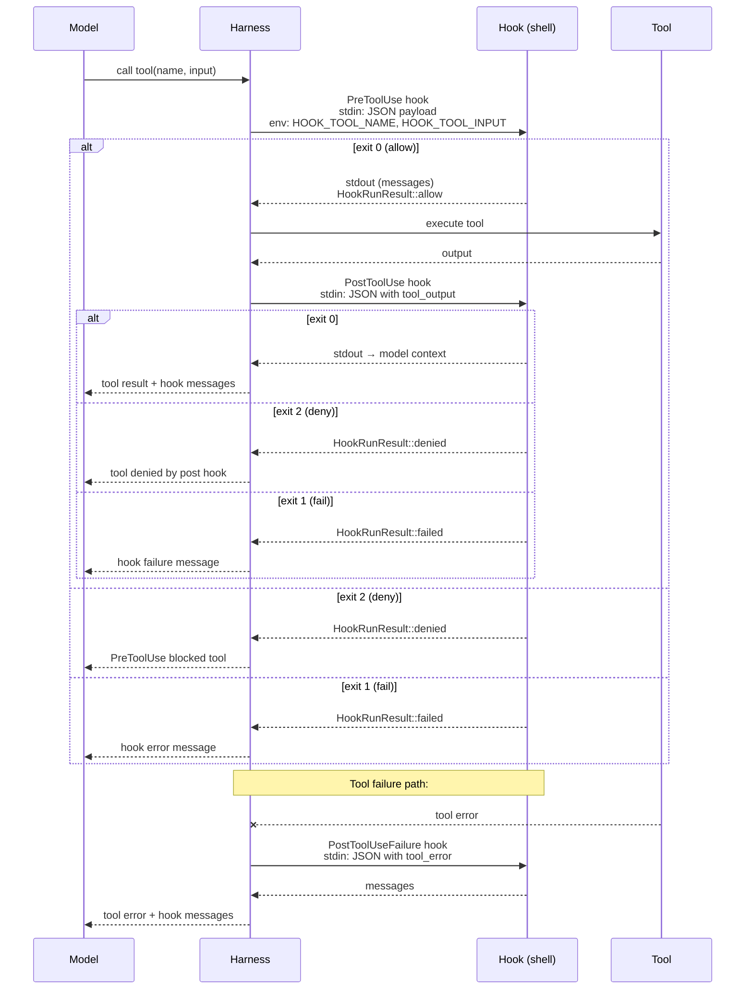

# Pattern 12 — Deterministic Lifecycle Hooks

> **Tóm tắt:** User-defined shell commands được execute tại các điểm xác định trong vòng đời agent: trước khi tool chạy (`PreToolUse`), sau khi tool chạy (`PostToolUse`), khi tool thất bại (`PostToolUseFailure`). Harness chạy hooks này — không phải model — đảm bảo chúng luôn fire bất kể model nói gì.

---

## Vấn đề nó giải quyết

Nếu chỉ dựa vào model để nhớ chạy tests sau khi sửa code:

```
❌ Dựa vào model:
   CLAUDE.md: "Always run `cargo test` after editing code"
   → Model có thể quên
   → Model có thể quyết định "không cần thiết lần này"
   → Model có thể bị distracted bởi context khác
   → Không có gì đảm bảo test được chạy

✅ Dùng hooks:
   settings.json: { "PostToolUse": ["cargo test --workspace"] }
   → Harness tự động chạy sau mỗi file write
   → Model nhận output (pass/fail) trong context
   → Model tự sửa nếu test fail
   → Human invariant được enforce ở tầng infrastructure
```

**Giải pháp:** Hooks là *infrastructure-level callbacks*, không phải instruction-level reminders. Harness fire chúng deterministically tại known lifecycle points. Model không thể bypass chúng — chúng không nằm trong model's judgment.

---

## Source code trong repo

| File | Vai trò |
|------|---------|
| [`bootstrap.rs:1–56`](../rust/crates/runtime/src/bootstrap.rs#L1) | `BootstrapPhase` + `BootstrapPlan` — startup lifecycle |
| [`hooks.rs:22–26`](../rust/crates/runtime/src/hooks.rs#L22) | `HookEvent` — 3 lifecycle events |
| [`hooks.rs:39–56`](../rust/crates/runtime/src/hooks.rs#L39) | `HookProgressEvent` — Started/Completed/Cancelled |
| [`hooks.rs:83–152`](../rust/crates/runtime/src/hooks.rs#L83) | `HookRunResult` — kết quả hook với permission override + message |
| [`hooks.rs:312–413`](../rust/crates/runtime/src/hooks.rs#L312) | `run_commands()` — execution engine với env vars + abort signal |
| [`hooks.rs:538–630`](../rust/crates/runtime/src/hooks.rs#L538) | `parse_hook_output()` — parse JSON response từ hook |
| [`hooks.rs:632–657`](../rust/crates/runtime/src/hooks.rs#L632) | `hook_payload()` — JSON payload gửi vào stdin của hook |
| [`config.rs:79–85`](../rust/crates/runtime/src/config.rs#L79) | `RuntimeHookConfig` — danh sách commands per lifecycle stage |
| [`plugin_lifecycle.rs:47–61`](../rust/crates/runtime/src/plugin_lifecycle.rs#L47) | `PluginState` — Unconfigured→Validated→Starting→Healthy/Degraded/Failed→Stopped |

---

## Mindset

Hãy nghĩ như Git hooks — nhưng ở tầng agent:

```bash
# Git hooks: chạy khi commit
.git/hooks/pre-commit  → chạy trước khi commit
.git/hooks/post-merge  → chạy sau khi merge

# Agent hooks: chạy khi tool được gọi
PreToolUse   → chạy trước khi tool execute
PostToolUse  → chạy sau khi tool execute thành công
PostToolUseFailure → chạy sau khi tool fail
```

Git hooks không hỏi bạn có muốn chạy không — chúng chạy deterministically mỗi khi Git thực hiện action. Agent hooks hoạt động y như vậy.

**Tại sao hooks quan trọng hơn CLAUDE.md instructions:**

| CLAUDE.md instructions | Lifecycle hooks |
|------------------------|-----------------|
| Soft enforcement: model có thể bỏ qua | Hard enforcement: harness luôn fire |
| Model phải "nhớ" | Infrastructure tự động |
| Chỉ là text trong prompt | Executable shell commands |
| Không có feedback tự động | Output feed về context model |
| Dễ bị override bởi long context | Không bị ảnh hưởng bởi context |

---

## Diagram



---

## Technical walkthrough

### 3 lifecycle events

```rust
// hooks.rs:22-26
pub enum HookEvent {
    PreToolUse,           // trước khi tool execute
    PostToolUse,          // sau khi tool execute (kể cả khi is_error=true)
    PostToolUseFailure,   // sau khi tool fail hoàn toàn (exception level)
}
```

**Sự khác biệt PostToolUse vs PostToolUseFailure:**
- `PostToolUse` với `is_error=true`: tool chạy xong nhưng trả về error (exit code != 0 trong bash, file not found trong read, v.v.)
- `PostToolUseFailure`: tool không thể execute được (panic, invalid input schema, v.v.)

```rust
// hooks.rs:206-211
pub fn run_post_tool_use(
    &self, tool_name: &str, tool_input: &str, tool_output: &str,
    is_error: bool,   // ← "kết quả là error" nhưng tool đã chạy xong
) -> HookRunResult
```

---

### RuntimeHookConfig: shell commands per stage

```rust
// config.rs:79-85
pub struct RuntimeHookConfig {
    pre_tool_use: Vec<String>,
    post_tool_use: Vec<String>,
    post_tool_use_failure: Vec<String>,
}
```

Configured trong `settings.json`:
```json
{
  "hooks": {
    "PreToolUse": [
      "bash -c 'echo \"About to call $HOOK_TOOL_NAME\"'"
    ],
    "PostToolUse": [
      "cargo fmt --check",
      "cargo clippy --workspace"
    ],
    "PostToolUseFailure": [
      "notify-send 'Tool failed: '$HOOK_TOOL_NAME"
    ]
  }
}
```

Multiple hooks per stage được chạy **tuần tự**. Nếu hook thứ nhất fail → dừng lại, không chạy hook thứ hai.

---

### Payload gửi vào hook: stdin + env vars

Harness gửi context cho hook qua hai kênh:

**Env vars** (quick access):
```bash
HOOK_EVENT        = "PreToolUse" | "PostToolUse" | "PostToolUseFailure"
HOOK_TOOL_NAME    = "bash" | "edit_file" | "read_file" | ...
HOOK_TOOL_INPUT   = '{"command":"git status"}'   # JSON string
HOOK_TOOL_IS_ERROR = "0" | "1"
HOOK_TOOL_OUTPUT  = "..." # chỉ có trong PostToolUse/Failure
```

**Stdin** (full JSON payload):
```json
{
  "hook_event_name": "PostToolUse",
  "tool_name": "edit_file",
  "tool_input": { "path": "src/lib.rs", "old_string": "...", "new_string": "..." },
  "tool_input_json": "{\"path\":\"src/lib.rs\", ...}",
  "tool_output": "file edited successfully",
  "tool_result_is_error": false
}
```

Hook script có thể dùng env vars cho simple checks hoặc parse stdin JSON cho complex logic:

```bash
#!/bin/bash
# PostToolUse hook: chạy tests khi file Rust được sửa

if [[ "$HOOK_TOOL_NAME" == "edit_file" || "$HOOK_TOOL_NAME" == "write_file" ]]; then
    path=$(echo "$HOOK_TOOL_INPUT" | jq -r '.path // ""')
    if [[ "$path" == *.rs ]]; then
        cargo test --workspace 2>&1
        exit $?
    fi
fi
exit 0
```

---

### HookRunResult: 4 outcomes

```rust
// hooks.rs:83-92
pub struct HookRunResult {
    denied: bool,            // hook nói "block tool này"
    failed: bool,            // hook script crash/error
    cancelled: bool,         // abort signal triggered
    messages: Vec<String>,   // text feed về model context
    permission_override: Option<PermissionOverride>,  // Allow/Deny/Ask override
    permission_reason: Option<String>,
    updated_input: Option<String>,  // hook có thể modify tool input!
}
```

**Exit code convention:**
```
exit 0   → Allow (với optional messages)
exit 2   → Deny (block tool) + optional message
exit 1   → Failed (hook crash) + optional message
killed   → Cancelled (abort signal)
```

**Updated input:** Hook có thể modify tool input trước khi tool chạy! Ví dụ: sanitize command, add flags, rewrite path. Harness sẽ dùng `updated_input` thay vì input gốc.

---

### parse_hook_output(): hook response protocol

Nếu hook output là valid JSON object, harness parse các fields đặc biệt:

```json
{
  "systemMessage": "Tests passed: 42",
  "reason": "optional block reason",
  "continue": false,
  "decision": "block",
  "hookSpecificOutput": {
    "additionalContext": "extra info for model",
    "permissionDecision": "allow" | "deny" | "ask",
    "permissionDecisionReason": "why",
    "updatedInput": { "command": "git status --short" }
  }
}
```

Nếu output không phải JSON → treat as plain text message → add vào model context.
Nếu output bắt đầu bằng `{` nhưng invalid JSON → harness log error với preview (để debug).

---

### HookProgressEvent: observability

```rust
// hooks.rs:39-56
pub enum HookProgressEvent {
    Started   { event, tool_name, command },
    Completed { event, tool_name, command },
    Cancelled { event, tool_name, command },
}
```

Parent có thể implement `HookProgressReporter` để theo dõi hook execution trong real-time — hữu ích cho UI progress indicators hoặc debug logging.

---

### HookAbortSignal: cancellation mechanism

```rust
// hooks.rs:62-81
pub struct HookAbortSignal {
    aborted: Arc<AtomicBool>,  // atomic, có thể share across threads
}
```

Khi user hủy operation (Ctrl+C), harness gọi `abort_signal.abort()`. Hook đang chạy bị `kill()` sau polling interval 20ms:

```rust
// hooks.rs:799-809
loop {
    if abort_signal.is_some_and(HookAbortSignal::is_aborted) {
        let _ = child.kill();
        let _ = child.wait_with_output();
        return Ok(CommandExecution::Cancelled);
    }
    match child.try_wait()? {
        Some(_) => return child.wait_with_output().map(CommandExecution::Finished),
        None => thread::sleep(Duration::from_millis(20)),
    }
}
```

---

### BootstrapPlan: session startup lifecycle

Khi session khởi động, `BootstrapPlan` orchestrate 12 phases theo thứ tự cố định:

```rust
// bootstrap.rs:24-39
pub fn claude_code_default() -> Self {
    Self::from_phases(vec![
        BootstrapPhase::CliEntry,
        BootstrapPhase::FastPathVersion,
        BootstrapPhase::StartupProfiler,
        BootstrapPhase::SystemPromptFastPath,   // load CLAUDE.md
        BootstrapPhase::ChromeMcpFastPath,      // MCP init
        BootstrapPhase::DaemonWorkerFastPath,   // background worker
        BootstrapPhase::BridgeFastPath,
        BootstrapPhase::DaemonFastPath,
        BootstrapPhase::BackgroundSessionFastPath,
        BootstrapPhase::TemplateFastPath,
        BootstrapPhase::EnvironmentRunnerFastPath,
        BootstrapPhase::MainRuntime,            // interactive session
    ])
}
```

`from_phases()` **deduplicates** khi build plan — phase có thể được thêm nhiều lần (từ nhiều sources) nhưng chỉ execute một lần:

```rust
// bootstrap.rs:42-49
pub fn from_phases(phases: Vec<BootstrapPhase>) -> Self {
    let mut deduped = Vec::new();
    for phase in phases {
        if !deduped.contains(&phase) {
            deduped.push(phase);   // giữ thứ tự xuất hiện đầu tiên
        }
    }
    Self { phases: deduped }
}
```

Điều này đảm bảo thứ tự startup **luôn deterministic** dù config được compose từ nhiều sources khác nhau.

---

### PluginState: MCP plugin lifecycle

MCP plugins (external tools) đi qua state machine riêng:

```rust
// plugin_lifecycle.rs:47-61
pub enum PluginState {
    Unconfigured,        // chưa có config
    Validated,           // config OK, chưa start
    Starting,            // đang khởi động MCP server
    Healthy,             // tất cả servers up
    Degraded {           // một số servers fail
        healthy_servers: Vec<String>,
        failed_servers: Vec<String>,
    },
    Failed { reason: String },  // tất cả servers fail
    ShuttingDown,        // đang tắt
    Stopped,             // đã dừng
}
```

`Degraded` state cho phép harness tiếp tục với subset of tools thay vì fail hoàn toàn — graceful degradation.

---

## Nếu bạn tự build

```python
# pseudo-code

import subprocess
import json
import os
from dataclasses import dataclass, field
from typing import Optional

@dataclass
class HookRunResult:
    denied: bool = False
    failed: bool = False
    cancelled: bool = False
    messages: list[str] = field(default_factory=list)
    permission_override: Optional[str] = None  # "allow" | "deny" | "ask"
    updated_input: Optional[dict] = None

class HookRunner:
    def __init__(self, pre_tool_use: list[str], post_tool_use: list[str], post_failure: list[str]):
        self.pre_commands = pre_tool_use
        self.post_commands = post_tool_use
        self.failure_commands = post_failure

    def run_pre_tool_use(self, tool_name: str, tool_input: dict) -> HookRunResult:
        return self._run_commands("PreToolUse", self.pre_commands, tool_name, tool_input)

    def run_post_tool_use(self, tool_name: str, tool_input: dict, tool_output: str) -> HookRunResult:
        return self._run_commands("PostToolUse", self.post_commands, tool_name, tool_input, tool_output)

    def _run_commands(
        self,
        event: str,
        commands: list[str],
        tool_name: str,
        tool_input: dict,
        tool_output: str | None = None,
    ) -> HookRunResult:
        result = HookRunResult()
        if not commands:
            return result

        # Build payload gửi qua stdin
        payload = {
            "hook_event_name": event,
            "tool_name": tool_name,
            "tool_input": tool_input,
            "tool_input_json": json.dumps(tool_input),
            "tool_output": tool_output,
            "tool_result_is_error": False,
        }

        for command in commands:
            env = {
                **os.environ,
                "HOOK_EVENT": event,
                "HOOK_TOOL_NAME": tool_name,
                "HOOK_TOOL_INPUT": json.dumps(tool_input),
                "HOOK_TOOL_IS_ERROR": "0",
            }
            if tool_output:
                env["HOOK_TOOL_OUTPUT"] = tool_output

            proc = subprocess.run(
                command, shell=True,
                input=json.dumps(payload).encode(),
                capture_output=True,
                env=env,
            )

            stdout = proc.stdout.decode().strip()
            outcome = self._parse_outcome(proc.returncode, stdout)

            if outcome == "allow":
                messages = self._parse_messages(stdout)
                result.messages.extend(messages)

            elif outcome == "deny":
                messages = self._parse_messages(stdout)
                result.messages.extend(messages)
                result.denied = True
                return result   # short-circuit

            elif outcome == "fail":
                result.failed = True
                result.messages.append(f"Hook `{command}` exited with {proc.returncode}")
                return result   # short-circuit

        return result

    def _parse_outcome(self, exit_code: int, stdout: str) -> str:
        if exit_code == 0:
            # Check JSON untuk "continue": false hoặc "decision": "block"
            try:
                data = json.loads(stdout)
                if data.get("continue") is False or data.get("decision") == "block":
                    return "deny"
            except (json.JSONDecodeError, TypeError):
                pass
            return "allow"
        elif exit_code == 2:
            return "deny"
        else:
            return "fail"

    def _parse_messages(self, stdout: str) -> list[str]:
        if not stdout:
            return []
        try:
            data = json.loads(stdout)
            messages = []
            if msg := data.get("systemMessage"):
                messages.append(msg)
            if msg := data.get("reason"):
                messages.append(msg)
            return messages
        except (json.JSONDecodeError, TypeError):
            return [stdout]  # plain text → as-is


# Usage trong agent loop:
hook_runner = HookRunner(
    pre_tool_use=["check-permissions.sh"],
    post_tool_use=["cargo test --workspace", "cargo clippy --workspace"],
    post_failure=[]
)

def call_tool(tool_name: str, tool_input: dict) -> str:
    # 1. Pre hook
    pre_result = hook_runner.run_pre_tool_use(tool_name, tool_input)
    if pre_result.denied:
        return f"Tool blocked: {' '.join(pre_result.messages)}"
    if pre_result.failed:
        return f"Pre-hook error: {' '.join(pre_result.messages)}"

    # Update input nếu hook modify nó
    actual_input = pre_result.updated_input or tool_input

    # 2. Execute tool
    output = execute_tool(tool_name, actual_input)

    # 3. Post hook (feed output về model context)
    post_result = hook_runner.run_post_tool_use(tool_name, actual_input, output)
    if post_result.messages:
        output += "\n\nHook output:\n" + "\n".join(post_result.messages)

    return output
```

Quy tắc thiết kế:

| Rule | Lý do |
|------|-------|
| Hooks chạy deterministically, không phụ thuộc model | Model không thể "quên" chạy tests — harness đảm bảo |
| Exit code convention: 0=allow, 2=deny, other=fail | Đơn giản, Unix-compatible; hook không cần parse phức tạp để deny |
| Payload qua stdin (JSON) + env vars (quick access) | Dual channel: simple hooks dùng env vars, complex hooks parse stdin |
| Multiple hooks per stage, short-circuit on fail | Cho phép compose nhiều checks; fail fast khi có vấn đề |
| Output feed về model context | Model nhận feedback tự động → self-correcting loop |
| `updated_input` cho phép hook modify input | Hook có thể sanitize/augment trước khi tool chạy |
| Abort signal cho cancellation | User Ctrl+C được propagate xuống hook processes |
| BootstrapPlan deduplication | Phase ordering deterministic dù config từ nhiều sources |

---

## Các cạm bẫy thường gặp

| Cạm bẫy | Hậu quả | Cách tránh |
|---------|---------|-----------|
| Hook chạy quá lâu | Mọi tool call đều chậm lại | Timeout hooks; dùng background jobs cho long-running checks |
| Hook thất bại silently (exit 0 nhưng không làm gì) | Checks "passed" mà không thực sự check | Hook phải exit 2 để deny hoặc in message để báo lỗi |
| PostToolUse hook làm fail tất cả tool calls | Mọi action của model bị block | Test hooks độc lập trước khi deploy; scope check theo `HOOK_TOOL_NAME` |
| Không scope hook theo tool type | `cargo test` chạy ngay cả khi chỉ read file | Check `$HOOK_TOOL_NAME` và `$HOOK_TOOL_INPUT` trước khi chạy heavy checks |
| Hook tạo side effects không mong muốn | Hook modify files → hook trigger lại → infinite loop | Hook phải idempotent; cẩn thận với recursive triggers |
| Không handle hook output encoding | Emoji, unicode, binary output → parse error | Luôn encode/decode UTF-8; trim whitespace trước khi parse |
| Multiple hooks, không clear về thứ tự | Race condition nếu hooks modify cùng state | Hooks chạy sequential, không parallel; document dependency |
| PreToolUse hook modify input thành invalid | Tool fail với cryptic error | Validate `updatedInput` trước khi return; ensure schema compliance |
